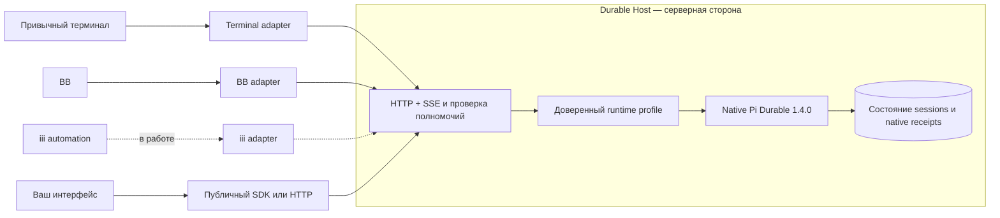

# Pi Durable Host

Один сервер для долговечной работы агентов. Начните разговор в терминале, закройте интерфейс и продолжите ту же работу через BB или собственный клиент — без второй копии runtime и без потери результата.

Это отдельный fork [disler/durable-pi](https://github.com/disler/durable-pi). Он сохраняет backend, SDK, Git-историю и MIT notices upstream. Поддерживаемая линия runtime — **Pi Durable 1.4.0**. Pocket и автоматическая совместимость обычных Pi extensions сюда не входят.

> **Статус: checkpoint, не готовый релиз.** Дефекты HTTP/SSE diagnostics и auth-case routing исправлены и прошли независимую проверку исходников. Единая приёмка всех пяти установленных пакетов ещё не завершена; iii остаётся экспериментальным и пока приостановлен. Исторические verdicts не заменяют проверку текущей сборки. [Что готово и что остаётся](docs/STATUS.md).

## Как это устроено

**Клиент показывает работу, сервер владеет ею.** Клиенты не открывают session SQLite, не запускают свою копию Harness и не получают права человека из полей JSON. Закрытие окна или потеря соединения не отменяет задачу.

### Что даёт проект

- **Независимые клиенты.** Backend, SDK, terminal, BB и iii — отдельные пакеты. Обновление одного адаптера не должно требовать обновления остальных.
- **Восстановление после обрыва.** Повтор принятой команды с тем же ключом сверяется с native receipt. Потерянный ответ не означает, что задачу нужно запустить заново.
- **Серверные полномочия.** Observer, человек и delegated worker имеют разные права. Parent-control проверяет настоящие child/execution IDs и текущую revision.
- **Свой runtime profile.** Модели, native extensions, инструменты, память и политики подключаются доверенным кодом на сервере, а не импортом модуля из HTTP-запроса.
- **Понятная проверяемость.** [План](docs/PLAN.md) и [статус](docs/STATUS.md) разделяют проверенные сценарии, экспериментальные части и ограничения. Приватные журналы проверок и локальные audit-материалы не входят в публичный репозиторий.

## С чего начать

Нужны Git, npm и Node.js **22.19+**. Изолированные проверки выполнялись также на Node 24. Начните с faux provider: он не обращается к платным моделям.

1. [Установить host и получить первый результат](docs/GETTING_STARTED.md).
2. [Подключить терминал, BB или SDK-клиент](docs/CONNECTING_CLIENTS.md).
3. [Подключить свой Durable profile, модели и native extensions](docs/CUSTOM_RUNTIME.md).
4. [Написать собственный адаптер](docs/BUILDING_ADAPTERS.md).
5. [Посмотреть архитектуру и поведение при обрыве](docs/ARCHITECTURE.md).

Пакеты `0.1.0` пока не обещаны в npm registry. Инструкции используют **сборку из исходников и локальные tarball**, а не несуществующий `npm install -g`.

## Если устанавливает агент

Готовые переносимые задания находятся в [docs/agents](docs/agents/README.md):

- [Безопасно установить и проверить](docs/agents/INSTALL.md).
- [Подключить существующий host и клиент](docs/agents/CONNECT.md).
- [Добавить собственный runtime profile](docs/agents/CUSTOM_PROFILE.md).
- [Создать новый адаптер](docs/agents/NEW_ADAPTER.md).

Промпты не требуют наших домашних каталогов, личных MCP, подписок или конкретной модели агента. Секреты передаются через выбранное окружение оператора, а не вставляются в промпт или Git.

## Важные ограничения

- CLI по умолчанию использует `minimal@1`. Полный native profile подключается отдельной доверенной серверной композицией; установка пакета не включает все интеграции автоматически.
- BB `/compact` явно отклоняется **до эффекта и подтверждения**: текущий публичный native API compaction не даёт канонического ключа повторения. Native SDK и терминал сохраняют свой существующий compaction API.
- Локальная BB-приёмка использовала настоящий native host и изолированный Core API fixture. Smoke на полной совместимой работающей версии BB ещё нужен перед production replacement.
- iii не считается принятым до сквозного теста и независимой проверки. Чужие namespace, caller metadata и поддельное `human` не должны давать полномочия.
- Перенос рабочих SQLite и переключение production не выполняются инструкцией установки. Для истории сначала нужны backup, остановленный владелец и проверенная копия.

## Для разработчиков

| Каталог | Назначение |
|---|---|
| `apps/dpi-backend` | Native owner, API, grants и серверные runtime profiles |
| `apps/dpi-sdk` | Публичный HTTP/SSE-клиент и wire types; без session storage |
| `apps/terminal-adapter` | Наш TUI поверх удалённого controller/view |
| `apps/bb-adapter` | BB thread binding, native children, история CAS и stdio bridge |
| `apps/iii-adapter` | Подписанный ingress и iii-клиент; текущую готовность см. в статусе |
| `docs/PLAN.md`, `docs/STATUS.md` | Публичный план, проверенные сценарии и открытые ограничения |
| `docs/agents` | Инструкции для установки и интеграций агентами |

Начните с [CONTRIBUTING.md](CONTRIBUTING.md). История коммитов разбивается по проверенным пакетам; незавершённая работа не называется релизом. Публикация Git-репозитория не равна публикации npm-пакетов или deployment.

## Лицензия и происхождение

[MIT](LICENSE), исходные copyright upstream сохранены. Baseline Disler: `37165c619573dbaf425463038bbffecfe576beec`. Заимствованные интеграционные алгоритмы отмечены в `NOTICE.md` и `SOURCE.json` соответствующих пакетов; [происхождение и символические source IDs](docs/PROVENANCE.md) описаны отдельно. Оригинальный проект и его документация: [disler/durable-pi](https://github.com/disler/durable-pi).
