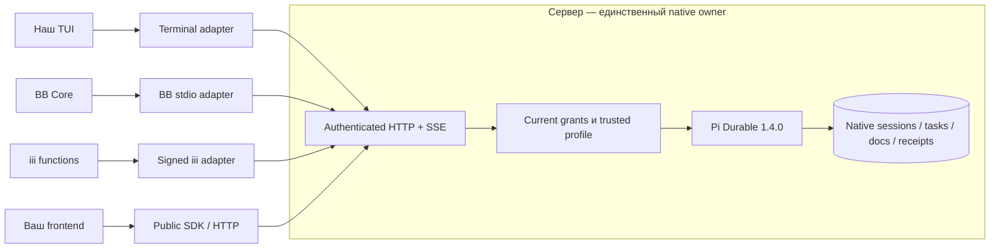

# Pi Durable Host

Один сервер для долговечной работы агентов и отдельные клиенты для терминала, BB, iii и своих интерфейсов. Начните разговор в терминале, закройте окно и подключитесь снова: сервер продолжает работу, а клиент восстанавливает её состояние и результат.

Это fork [disler/durable-pi](https://github.com/disler/durable-pi), а не новый agent framework. Он сохраняет backend, SDK, Git-историю и MIT notices upstream; native **Pi Durable 1.4.0** владеет sessions, tasks, документами и восстановлением. Pocket не используется.

> **Локальная приёмка P0–P5 пройдена.** Проверены пять отдельных пакетов, **193/193 теста**, установка из tarballs, native HTTP/SSE, signed iii jobs и mixed-version terminal + BB. Из 53 критериев подтверждён 51; два миграционных проверены лишь на disposable same-version копиях. Это не production-сертификация, npm release или разрешение переносить рабочие данные. [Точный scope и ограничения](docs/STATUS.md).

## Что можно делать

- **Продолжать ту же работу из разных клиентов.** Наш TUI сохраняет editor, navigation, tool streaming, interrupt/steer и durable attention. BB привязывает thread к существующей native conversation, а не создаёт второй runtime.
- **Безопасно повторять команды после обрыва.** Тот же request key с тем же телом возвращает canonical native receipt. Изменённое тело отклоняется; потерянный ACK не означает, что нужно запускать работу заново.
- **Запускать delegated jobs из iii.** Подписанный ingress проверяет session/function/payload; сервер проверяет доверенные namespace/config/worker binding и grant. Завершённый ответ читается по неизменяемому native `answerRef`, в том числе после owner/client restart.
- **Подключать свой runtime.** Модели, native extensions, MCP, memory, guards, Goal и schedules задаёт доверенная серверная композиция. Клиент не выбирает модуль из HTTP body и не получает human authority из полей JSON.
- **Писать свой frontend без Harness и SQLite.** Публичный SDK и HTTP/SSE дают protocol/capability discovery, sessions, native receipts, entries и stream. Адаптеры устанавливаются и обновляются отдельно.

## Архитектура

**Клиент показывает работу, сервер владеет ею.** Закрытие последнего клиента не останавливает задачу. Disconnect ожидающего `run` не отменяет принятый iii job; pending stop receipt ещё не означает, что native stop уже выполнен.

## Первый запуск

Нужны Git, npm и Node.js **22.19+**; локальные проверки выполнялись на Node 24. Начните с нового каталога данных и faux provider: без платных моделей и частных интеграций.

1. [Собрать backend/SDK, запустить минимальный host и получить ответ](docs/GETTING_STARTED.md).
2. [Подключить terminal, BB или iii](docs/CONNECTING_CLIENTS.md).
3. [Подключить свой native profile и модели](docs/CUSTOM_RUNTIME.md).
4. [Написать новый адаптер](docs/BUILDING_ADAPTERS.md).

Пакеты `0.1.0` **не опубликованы в npm registry**. Инструкции используют локальные tarballs из этого checkout. [Quick start](docs/GETTING_STARTED.md) содержит буквальные SDK и curl примеры со стабильными ключами; для повторного запуска сохраняйте те же ключи, тело и data directory.

### Выберите нужный клиент

| Клиент | Как подключается | Что подготовить |
|---|---|---|
| Terminal | `dpi-terminal URL SESSION_ID` | SDK + terminal tarball, URL и server credential |
| BB | `dpi-bb-provider`, JSON-RPC по stdin/stdout | Совместимый Core, trusted native profile, точные thread/root/child bindings |
| iii | `dpi-iii-worker --config FILE` | Trusted native profile с `native-iii.v2`, delegated grant, config binding и public signing key |
| Свой frontend | `DpiClient` или authenticated HTTP/SSE | Protocol/capability discovery, stable request keys и безопасное хранение credential |

Минимальный CLI использует `minimal@1`: он не включает все native-интеграции автоматически. Для BB, iii и расширенного inventory нужна [явная серверная композиция](docs/CUSTOM_RUNTIME.md). Установка одного клиента не требует backend/Harness или двух других адаптеров в его install-каталоге.

## Полномочия и восстановление

Observer читает разрешённое состояние; delegated worker выполняет только выделенные операции; human admission остаётся за человеком. Parent-control сверяет настоящие child/execution IDs и текущую revision. Revoke действует на последующие чтения/команды и открытые защищённые streams.

Неизвестный исход отправки сверяется по прежнему request key. Публичные ошибки не раскрывают внутренние причины и credentials. Отсутствующая сохранённая модель или несовместимый profile дают явный отказ до resume, а не тихую замену.

[Архитектура и recovery](docs/ARCHITECTURE.md) · [Контракт SDK](apps/dpi-sdk/README.md) · [Native composition](apps/dpi-backend/NATIVE.md)

## Границы проверки

- **BB `/compact` unsupported:** отказ до эффекта и accepted ACK. Native compaction API не даёт canonical idempotency key; SDK и терминал сохраняют свой compaction API.
- BB проверен с настоящим native host и изолированным Core API fixture. Полный совместимый running-BB smoke ещё нужен перед production replacement.
- iii проверен через настоящий pinned `iii-sdk`, подписанный ingress и loopback function transport с native faux host. Это не тест production iii engine или живых моделей.
- Mixed-version проверка соединяет terminal + BB с одним host/session/conversation. iii проверяется отдельным потоком на том же backend/SDK tuple; одновременная работа всех трёх не заявляется.
- Историческая/cross-version миграция, рабочие SQLite, production, личные memory banks и произвольные plugins не считаются проверенными. Compile success не доказывает native recovery compatibility.

## Если устанавливает агент

Переносимые задания находятся в [docs/agents](docs/agents/README.md): [установка](docs/agents/INSTALL.md), [подключение](docs/agents/CONNECT.md), [свой profile](docs/agents/CUSTOM_PROFILE.md), [новый адаптер](docs/agents/NEW_ADAPTER.md). Они не требуют наших домашних каталогов, личных MCP, подписок или конкретной модели агента. Не вставляйте secrets в prompt, URL, Git или отчёт.

## Для разработчиков

| Каталог | Назначение |
|---|---|
| `apps/dpi-backend` | Native owner, authenticated API, grants и runtime profiles |
| `apps/dpi-sdk` | Публичные HTTP/SSE types и клиент, без session storage |
| `apps/terminal-adapter` | Наш TUI поверх remote controller/view |
| `apps/bb-adapter` | Thread binding, native children, history CAS и stdio bridge |
| `apps/iii-adapter` | Signed function ingress, SDK jobs/control/result |
| `docs` | Установка, интеграции, архитектура, статус и agent prompts |

Начните с [CONTRIBUTING.md](CONTRIBUTING.md). [План](docs/PLAN.md) отделяет выполненную локальную реализацию от миграции и production. Приватные журналы, audit-материалы, session data и ключи в публичный репозиторий не входят.

## Лицензия

[MIT](LICENSE); исходные copyright upstream сохранены. Baseline Disler: `37165c619573dbaf425463038bbffecfe576beec`. Заимствованные алгоритмы отмечены в `NOTICE.md` и `SOURCE.json` пакетов; оригинальные и локальные hashes различаются. [Происхождение и символические source IDs](docs/PROVENANCE.md).
