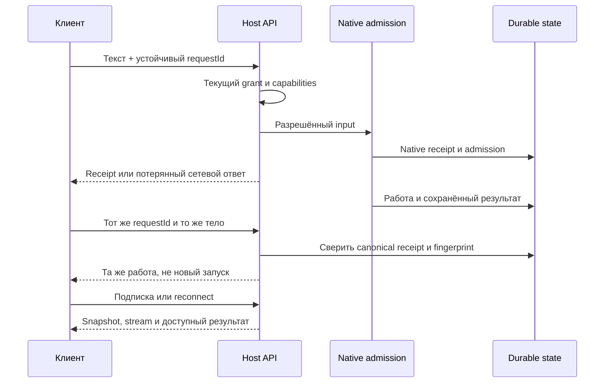
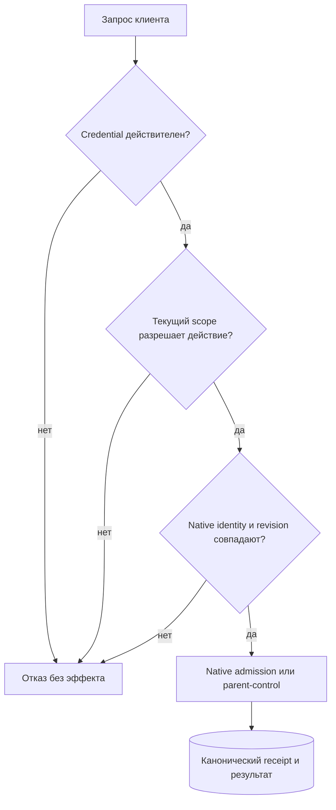
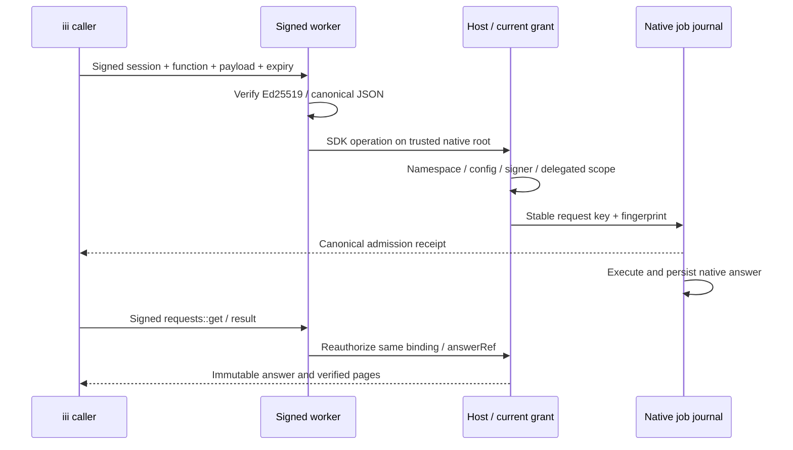

# Архитектура: отдельные клиенты, один native owner

## Три слоя

1. **Client adapter** переводит действия интерфейса в публичный wire API. У него нет session SQLite или своего Harness.
2. **Host** проверяет credential, scope и protocol capabilities. Он управляет жизненным циклом sessions и открывает каждую базу одним активным владельцем.
3. **Native Pi Durable profile** определяет модели, registry, инструменты и политики. Состояние задач, документов, admission и recovery остаётся native.

Session — не HTTP-соединение и не BB thread. В session может быть несколько conversations, в том числе дочерние. Один conversation могут наблюдать несколько клиентов.

## Обычный запрос и потерянный ответ

**ACK не равен результату.** `queued`, работающий run, terminal outcome и неизвестный исход — разные состояния. Пустой stream, `busy=false` или исчезнувший task не доказывают успешного ответа.

Если повтор использует тот же key с другим текстом, mode или target, он должен получить conflict. Клиент не генерирует новый key автоматически, чтобы скрыть неоднозначность.

## Кому принадлежат полномочия

Поля `human`, `actor`, `source`, имя worker или инструменты в JSON не меняют серверный grant. Клиентская metadata — данные, не authority. Для child control нужны реальные parent/child/execution/request IDs и актуальная revision; generic abort не подменяет native stop.

## iii: подпись, job и сохранённый результат

Disconnect ожидания не отменяет принятый job. `answerRef` адресует сохранённый native ответ в разрешённом binding; временный page cursor может сброситься при owner restart. Тогда чтение начинается заново с тем же reference, а не новым job key. У stop отдельно существуют принятый intent, pending receipt и реально завершённый native effect.

## Profile и изоляция

Каждая session получает собственные model capability, environment, MCP resources и пути логов. Нельзя выдавать успешный single-session тест за доказательство безопасности process-global интеграции в нескольких sessions.

Сохранённый profile ID и registry — часть совместимости. Нет нужной сохранённой модели или definitions — явная ошибка до resume, без тихого remap.

## Что не обещано

- Бесшовный live перенос owner между процессами.
- Подключение произвольной старой SQLite без проверки registry.
- Совместимость всех обычных Pi extensions после одной компиляции.
- Доказательство полного BB UI repaint по измерению API-delta.
- Production readiness по одному локальному faux smoke.

[План](PLAN.md) · [Проверенный scope](STATUS.md) · [Runtime profile](CUSTOM_RUNTIME.md) · [Новый адаптер](BUILDING_ADAPTERS.md). Приватная ISA и raw review-материалы не входят в публичную поставку.
