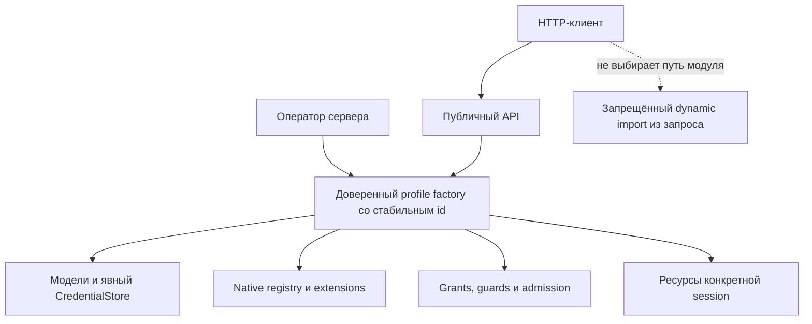

# Свой Durable, модели и native extensions

«Подключить свой Durable» может означать две разные задачи.

1. **Свой набор моделей, инструментов и native extensions.** Подключается через доверенный серверный runtime profile.
2. **Уже работающий процесс или старая SQLite.** Это не live attach: нельзя открыть её вторым владельцем или обещать совместимость произвольного registry. Сначала остановка, backup, disposable copy и проверка сохранённых definitions. Реальные миграции не входят в quick start.

## Граница расширения



Backend/SDK остаются общими. Ваш profile выбирается серверным entry point, а не параметром непроверенного клиента.

## Минимальный собственный profile

Установите backend/SDK tarball в отдельный каталог, как в [quick start](GETTING_STARTED.md). Сохраните в нём `custom-host.mjs`:

```js
import { Store } from 'dpi-backend/store';
import { minimalProfile } from 'dpi-backend/profiles';
import { createHttpServer, GrantPolicy } from 'dpi-backend/server';

const { DPI_HOME, DPI_START_DIRS, DPI_TOKEN } = process.env;
if (!DPI_HOME || !DPI_START_DIRS || !DPI_TOKEN) throw Error('Нужны явные disposable paths и credential');
const policy = new GrantPolicy([{
  id: 'local-operator', token: DPI_TOKEN, actor: 'local-operator',
  source: 'terminal', authority: 'human',
  permissions: ['read', 'write', 'control', 'filesystem', 'human-accept'],
  binding: {},
}]);
const profile = Object.assign(
  context => minimalProfile(context),
  { id: 'my-coding-profile@1' },
);
const store = await Store.open({
  dataDir: DPI_HOME, startDirs: [DPI_START_DIRS], name: 'custom-host',
  provider: 'faux', profile,
});
const server = createHttpServer(store, policy).listen(4781, '127.0.0.1');
let closing = false;
const close = async () => {
  if (closing) return;
  closing = true;
  server.close(); server.closeAllConnections();
  await store.close();
};
process.once('SIGINT', close);
process.once('SIGTERM', close);
```

Это настоящий второй profile со своим ID, но пока с минимальными coding tools. Используйте **новую** data directory и новый endpoint. Профиль `my-coding-profile@1` не должен молча открывать session, сохранённую как `minimal@1`.

```sh
DPI_HOME=/ABSOLUTE/NEW/DATA \
DPI_START_DIRS=/ABSOLUTE/TEST/WORKSPACE \
DPI_TOKEN="$DPI_TOKEN" node custom-host.mjs
```

Места `/ABSOLUTE/...` заменяет оператор. Не копируйте сюда путь рабочей базы.

## Полный native profile

Для Goal, parent-control, BB bindings, per-session memory/Mail, scoped models и внешних инструментов используйте экспорт `createNativeProfile` из `dpi-backend/native-profile`. Точная композиция и доступные опции описаны в [NATIVE.md](../apps/dpi-backend/NATIVE.md).

Важные контракты:

- `policy` и `owner` задаёт сервер; body запроса не может назначить себе authority, tool scope или policy reference.
- `models.create(context)` возвращает изолированную capability для каждой session. CredentialStore и разрешённые providers передаются явно. Отсутствующая сохранённая модель — ошибка, не повод подобрать похожую.
- `connectMcp(context)` создаёт отдельные подключения и возвращает `close`. Память и логи привязаны к session; process-global окружение не используется как изоляция.
- `github(context)` принимает явные session-local environment/transport; перед write после awaited read повторно проверяется current root authority. `tracing(context)` принимает явный session-local metadata-only SDK; ни ambient credentials, ни message/tool payloads не подхватываются. Не настроенные capability остаются unavailable/disabled.
- Новый native registry регистрирует настоящие task/document definitions. Успешная компиляция extension не доказывает, что её сохранённые задачи можно восстановить.
- Shell остаётся за fail-closed guard. Не отключайте DCG или admission ради зелёного smoke-теста.
- `bind` выполняется до resume, затем owner управляет shutdown/cleanup. Ошибка bootstrap не должна оставлять второй owner или утекшие подключения.

Не публикуйте bearer tokens, ключи провайдеров, приватные MCP headers, содержимое memory banks или пользовательские transcripts. Локальные секреты не должны входить в profile ID, `SOURCE.json`, fixture или коммит.

## Как проверить свой profile

1. Fresh HOME/dataDir и faux provider; без живых моделей.
2. Создание session, input → реальный tool/result → native receipt.
3. Закрытие host и reopen с тем же registry/ID сохраняют native identities.
4. Другой или отсутствующий profile ID отказывает **до** resume.
5. Две sessions с разными workspace/credentials не смешивают память, логи и MCP.
6. Observer/delegated не получают human mutation; revoke действует на новые операции и открытый stream.

Только после этих проверок обсуждайте реальные credentials и поддерживаемую копию конкретной истории. Переход production требует отдельного решения оператора.
