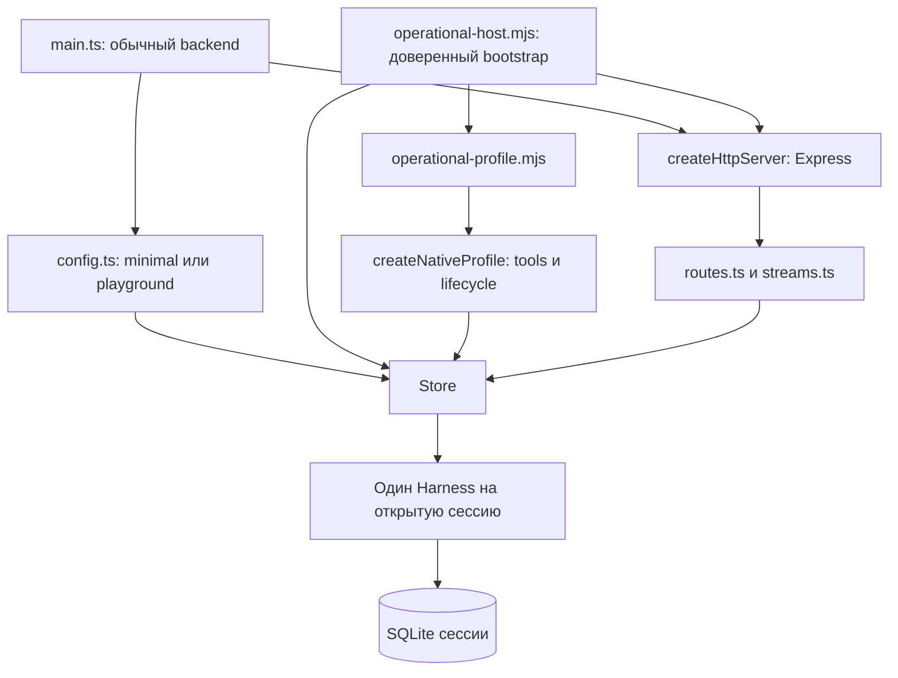

# Карта текущего Host: где читать и где менять

[Оглавление пакета](README.md) · [Отличия от Disler](CHANGES.md) · [Картинки и Express](IMAGES-AND-HTTP.md) · [Вариант Zero](zero/README.md)

**Это карта опубликованного кода, не карта целевого состояния.** Основа — снимок `830ad61af22b1585f1358896f286acd40492c7ca`, снятый 2026-11-02 в 19:24:25 UTC. При подготовке этой карты продуктовые исходники в рабочем checkout совпадали со снимком; новая публикация добавляет документацию, а не новый runtime. Запущенную production-установку здесь не проверяли.

## 1. Сначала различить три слоя

| Слой | Что действительно существует | Где смотреть |
|---|---|---|
| Исходный Disler | Backend, SDK, каталог сессий, Durable Harness, HTTP/SSE, примеры | [Baseline `37165c6`](https://github.com/disler/durable-pi/tree/37165c619573dbaf425463038bbffecfe576beec) |
| Наш Host | Авторизация и admission, operational profile, terminal-adapter, инструменты, MCP, memory, automation, reload; незаконченный перенос 1.4 → 1.5 | Эта ветка; [перечень изменений](CHANGES.md) |
| Внешняя композиция Zero | Исследованный вариант повторного использования публичных компонентов без изменения Zero | [Отдельное предложение](zero/ARCHITECTURE.md); **не подключено к Host** |

## 2. Точки входа: «запустить backend» не значит «получить весь профиль»



- [`apps/dpi-backend/src/main.ts`](../../apps/dpi-backend/src/main.ts) читает [`config.ts`](../../apps/dpi-backend/src/config.ts), выбирает `minimalProfile` либо `playgroundProfile`, открывает каталог и HTTP. `minimal` устанавливает CodingTools; `playground` добавляет исходные demos/jobs/addons. Эти профили определены в [`runtime-profile.ts`](../../apps/dpi-backend/src/runtime-profile.ts).
- [`experiments/sdk-host-cutover/operational-host.mjs`](../../experiments/sdk-host-cutover/operational-host.mjs) — отдельная существующая точка сборки полного профиля. Она проверяет приватную конфигурацию, создаёт GrantPolicy и operational profile, затем передаёт профиль в тот же Store и HTTP-сервер. **Приватный конфиг в публикацию не входит.**
- [`operational-profile.mjs`](../../experiments/sdk-host-cutover/operational-profile.mjs) связывает серверные credentials, models, trusted workspaces, MCP, memory, tracing и необязательный DeLM. [`native-profile/profile.ts`](../../apps/dpi-backend/src/native-profile/profile.ts) собирает native extensions. Это не второй агентный движок.

Название каталога `experiments/` само по себе не делает файл неиспользуемым: там есть operational composition, патчеры, установщики и исторические проверки. Но наличие такого файла также не доказывает, что именно его версия сейчас установлена.

## 3. Путь сообщения — по исходникам

```text
terminal main / UI
  → RemoteController + SubmissionJournal: текст, requestId, намерение
  → dpi-sdk Agent.send(content: string)
  → Express /v1 + bearer/grant authorization
  → routes.ts: POST messages
  → Store.send: проверки, actor-scoped ключ, fingerprint, admission
  → native Conversation.submit
  → Durable: задачи, модель, инструменты, история, восстановление

наблюдение результата:
  native state / watchEvents
  → streams.ts: SSE
  → dpi-sdk: wire validation / projection
  → terminal-adapter: отображение
```

Точные входы:

1. [`terminal-adapter/src/main.ts`](../../apps/terminal-adapter/src/main.ts), [`remote-controller.ts`](../../apps/terminal-adapter/src/remote-controller.ts), [`submission-journal.ts`](../../apps/terminal-adapter/src/submission-journal.ts).
2. [`dpi-sdk/src/client.ts`](../../apps/dpi-sdk/src/client.ts), `Agent.send`; DTO — [`api.ts`](../../apps/dpi-sdk/src/api.ts), `SendMessageBody`.
3. [`http-server.ts`](../../apps/dpi-backend/src/http-server.ts), [`auth.ts`](../../apps/dpi-backend/src/auth.ts), [`routes.ts`](../../apps/dpi-backend/src/routes.ts).
4. [`store.ts`](../../apps/dpi-backend/src/store.ts), `send`, `messageReceipt`, `reconcileMessage`, `initializeAgent`.
5. [`streams.ts`](../../apps/dpi-backend/src/streams.ts), [`observation-wire.ts`](../../apps/dpi-sdk/src/observation-wire.ts), [`observation.ts`](../../apps/dpi-sdk/src/observation.ts).

Отправка, получение результата и SSE — разные операции. Потеря ответа не даёт права создать новый requestId и повторить действие; сначала нужен receipt/reconcile. Ни HTTP, ни терминал не должны запускать второй Harness для той же сессии.

## 4. Владельцы состояния и ресурсов

| Объект | Реальный владелец в снимке | Граница |
|---|---|---|
| Каталог, список сессий, открытие/закрытие | [`Store`](../../apps/dpi-backend/src/store.ts) | Каталог не является второй историей разговора |
| Общие документы | [`SharedState`](../../apps/dpi-backend/src/shared-state.ts) → [`durable/shared-state.ts`](../../apps/dpi-backend/src/durable/shared-state.ts) | Уже вынесенная часть; не доказательство переноса всего Store |
| Session storage и Harness | `Store.initializeAgent` открывает storage и `Harness.open`, вызывает `profile.bind`, затем `resume` | bind до resume — важное условие lifecycle |
| Модели, registry, инструменты | [`native-profile`](../../apps/dpi-backend/src/native-profile) и выбранный RuntimeProfileFactory | Провайдеры и credentials остаются серверными |
| Grant/scope/authority | [`grants.ts`](../../apps/dpi-backend/src/grants.ts), [`auth.ts`](../../apps/dpi-backend/src/auth.ts), [`native-profile/admission`](../../apps/dpi-backend/src/native-profile/admission) | Текст prompt не является разрешением |
| Reload | [`durable-reload`](../../packages/durable-reload/src/index.ts), profile prepare/bind/shutdown/cleanup | Подготовка, публикация, освобождение ресурсов; не горячая замена ядра |
| Черновик и неопределённая отправка | [`SubmissionJournal`](../../apps/terminal-adapter/src/submission-journal.ts) | Локальная запись не означает серверный admission |

## 5. Незаконченная граница, которую нельзя скрыть на схеме

В снимке `Store` всё ещё открывает native Harness и вызывает native операции. `routes.ts` импортирует native `Conversation`/`Harness`, а `streams.ts` использует `watchEvents` из 1.4. Поэтому текущая зависимость — **HTTP/Store → native API**, а не полностью реализованное **HTTP → независимый runtime port**.

Новые [`durable/session.ts`](../../apps/dpi-backend/src/durable/session.ts), [`native-session.ts`](../../apps/dpi-backend/src/durable/native-session.ts) и [`CONTRACT.md`](../../apps/dpi-backend/src/durable/CONTRACT.md) задают и частично реализуют будущую глубокую границу. Полная переадресация Host на неё **не завершена**. [DM1](../host-design/hot-update/DURABLE-MODULE-PLAN.md) остаётся планом этой работы.

Размеры файлов в снимке: `Store` — 1901 строка, `routes.ts` — 277, `streams.ts` — 284, `native-session.ts` — 486. Это подсказка для навигации и оценки связности, **не измерение скорости или памяти**.

## 6. «Хочу изменить X» → куда идти

| Изменение | Начать здесь | Что сохранить / проверить |
|---|---|---|
| Входные изображения | [`SendMessageBody`](../../apps/dpi-sdk/src/api.ts), [`Agent.send`](../../apps/dpi-sdk/src/client.ts), Store.send, terminal journal | Валидация, лимиты, fingerprint, повторное чтение journal и receipt/reconcile; [разбор](IMAGES-AND-HTTP.md) |
| Убрать Express | [`http-server.ts`](../../apps/dpi-backend/src/http-server.ts), routes/auth/errors/streams | Авторизация до обработчика, ошибки/статусы, размер тела, SSE backpressure/abort, отключение клиента |
| Завершить переход на Durable 1.5 | Store/routes/streams + [`src/durable`](../../apps/dpi-backend/src/durable) | Один native owner, watch contract, lifecycle, sanitization, authorization patch, отдельная сборка |
| Добавить tool или MCP | [`native-profile/profile.ts`](../../apps/dpi-backend/src/native-profile/profile.ts), [`tools`](../../apps/dpi-backend/src/native-profile/tools), [`guards/mcp-codemode.ts`](../../apps/dpi-backend/src/native-profile/guards/mcp-codemode.ts), [`session-mcp.mjs`](../../experiments/sdk-host-cutover/session-mcp.mjs) | Registry, права, session scope, cleanup и reload; не второй loader |
| Изменить модели | [`native-profile/models`](../../apps/dpi-backend/src/native-profile/models), [`operational-models.mjs`](../../experiments/sdk-host-cutover/operational-models.mjs) | Доверенный credential owner, проверка сохранённой модели до recovery |
| Изменить memory/tracing | [`memory`](../../apps/dpi-backend/src/native-profile/memory), [`tracing`](../../apps/dpi-backend/src/native-profile/tracing), operational profile | Исходные Storage/Harness, порядок bind/resume/shutdown |
| Изменить Goal/schedules/subagents | [`native-profile/automation`](../../apps/dpi-backend/src/native-profile/automation), [`subagents`](../../apps/dpi-backend/src/native-profile/subagents), [`operator`](../../apps/dpi-backend/src/native-profile/operator) | Durable остаётся исполнителем; права parent/operator не заменяются строкой source |
| Изменить TUI | [`terminal-adapter`](../../apps/terminal-adapter/src) | Клиентская проекция и UX, без локального владельца session SQLite |
| Подключить BB/iii | [`bb-adapter`](../../apps/bb-adapter), [`iii-adapter`](../../apps/iii-adapter), SDK | Внешний транспорт/контроллер, не новый runtime; наличие кода не равно приёмке |
| Вынести расширения / использовать Zero | [EXTENSIONS](zero/EXTENSIONS.md), [ARCHITECTURE](zero/ARCHITECTURE.md) | Сначала проверить публичные API и lifecycle; пакетное разделение не меняет владельца состояния |

## 7. Что эта карта не доказывает

Это статическая проверка исходников. Она не подтверждает установленную production-версию, сквозную работоспособность снимка, визуальный рендер схем или преимущество одного HTTP-framework. Ранее зафиксированные typecheck-проблемы остаются в [STATUS](STATUS.md); публикация документации их не исправляет.
