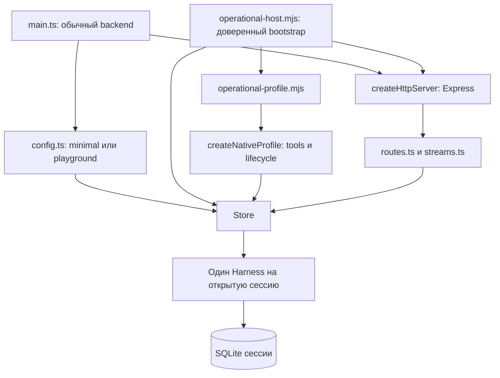

# Карта исходников Host

[Оглавление пакета](README.md) · [Отличия от Disler](CHANGES.md) · [Изображения и Express](IMAGES-AND-HTTP.md) · [Вариант Zero](zero/README.md)

Справочник описывает опубликованный код, а не целевое состояние. Основа карты: снимок `830ad61af22b1585f1358896f286acd40492c7ca` от 2026-11-02, 19:24:25 UTC. При подготовке карты продуктовые исходники рабочего checkout совпадали со снимком.

Новая публикация добавляет документацию, а не runtime. Запущенная production-установка здесь не проверялась.

## 1. Исходный проект, наш Host и предложение Zero

| Слой | Существующие компоненты или статус | Источник |
|---|---|---|
| Исходный Disler | Backend, SDK, каталог сессий, Durable Harness, HTTP, SSE и примеры | [Baseline `37165c6`](https://github.com/disler/durable-pi/tree/37165c619573dbaf425463038bbffecfe576beec) |
| Наш Host | Авторизация, admission, operational profile, terminal-adapter, инструменты, MCP, memory, automation и reload. Перенос 1.4 → 1.5 не завершён | Эта ветка и [перечень изменений](CHANGES.md) |
| Внешняя композиция Zero | Исследованное предложение использовать публичные компоненты без изменения Zero. К Host не подключено | [Предложение Zero](zero/ARCHITECTURE.md) |

## 2. Точки входа и профили

Запуск обычного backend не включает весь operational-профиль.



[`apps/dpi-backend/src/main.ts`](../../apps/dpi-backend/src/main.ts) читает [`config.ts`](../../apps/dpi-backend/src/config.ts). Он выбирает `minimalProfile` либо `playgroundProfile`, открывает каталог и HTTP. Профиль `minimal` устанавливает CodingTools. Профиль `playground` добавляет исходные demos/jobs/addons. Определения находятся в [`runtime-profile.ts`](../../apps/dpi-backend/src/runtime-profile.ts).

[`experiments/sdk-host-cutover/operational-host.mjs`](../../experiments/sdk-host-cutover/operational-host.mjs) собирает полный профиль. Он проверяет приватную конфигурацию, создаёт GrantPolicy и operational profile. Затем он передаёт профиль в тот же Store и HTTP-сервер. Приватный конфиг не входит в публикацию.

[`operational-profile.mjs`](../../experiments/sdk-host-cutover/operational-profile.mjs) связывает серверные credentials, models, trusted workspaces, MCP, memory, tracing и необязательный DeLM. [`native-profile/profile.ts`](../../apps/dpi-backend/src/native-profile/profile.ts) собирает native extensions. Эти компоненты не создают второй агентный движок.

В `experiments/` находятся operational composition, патчеры, установщики и исторические проверки. Название каталога не означает, что файл не используется. Наличие файла также не доказывает, что эта версия установлена.

## 3. Путь сообщения

```text
terminal main / UI
  → RemoteController + SubmissionJournal: текст, requestId, намерение
  → dpi-sdk Agent.send(content: string)
  → Express /v1 + bearer/grant authorization
  → routes.ts: POST messages
  → Store.send: проверки, actor-scoped ключ, fingerprint, admission
  → native Conversation.submit
  → Durable: задачи, модель, инструменты, история, восстановление

наблюдение результата:
  native state / watchEvents
  → streams.ts: SSE
  → dpi-sdk: wire validation / projection
  → terminal-adapter: отображение
```

Следующие файлы задают этапы пути.

1. [`terminal-adapter/src/main.ts`](../../apps/terminal-adapter/src/main.ts), [`remote-controller.ts`](../../apps/terminal-adapter/src/remote-controller.ts), [`submission-journal.ts`](../../apps/terminal-adapter/src/submission-journal.ts) обрабатывают клиентское намерение.
2. [`dpi-sdk/src/client.ts`](../../apps/dpi-sdk/src/client.ts) содержит `Agent.send`. [`api.ts`](../../apps/dpi-sdk/src/api.ts) определяет DTO `SendMessageBody`.
3. [`http-server.ts`](../../apps/dpi-backend/src/http-server.ts), [`auth.ts`](../../apps/dpi-backend/src/auth.ts), [`routes.ts`](../../apps/dpi-backend/src/routes.ts) задают HTTP и авторизацию.
4. [`store.ts`](../../apps/dpi-backend/src/store.ts) содержит `send`, `messageReceipt`, `reconcileMessage` и `initializeAgent`.
5. [`streams.ts`](../../apps/dpi-backend/src/streams.ts), [`observation-wire.ts`](../../apps/dpi-sdk/src/observation-wire.ts), [`observation.ts`](../../apps/dpi-sdk/src/observation.ts) задают поток наблюдения.

Отправка, получение результата и SSE являются разными операциями. Потеря ответа не разрешает создать новый `requestId` и повторить действие. Сначала требуется `receipt` или `reconcile`. Ни HTTP, ни терминал не должны запускать второй Harness для той же сессии.

## 4. Владельцы состояния и ресурсов

| Объект | Владелец в снимке | Граница |
|---|---|---|
| Каталог, список сессий, открытие и закрытие | [`Store`](../../apps/dpi-backend/src/store.ts) | Каталог не является второй историей разговора |
| Общие документы | [`SharedState`](../../apps/dpi-backend/src/shared-state.ts), [`durable/shared-state.ts`](../../apps/dpi-backend/src/durable/shared-state.ts) | Эта часть уже вынесена; перенос всего Store не завершён |
| Session storage и Harness | `Store.initializeAgent` открывает storage и `Harness.open`, вызывает `profile.bind`, затем `resume` | `bind` должен предшествовать `resume` |
| Модели, registry и инструменты | [`native-profile`](../../apps/dpi-backend/src/native-profile) и выбранный RuntimeProfileFactory | Провайдеры и credentials остаются серверными |
| Grant, scope и authority | [`grants.ts`](../../apps/dpi-backend/src/grants.ts), [`auth.ts`](../../apps/dpi-backend/src/auth.ts), [`native-profile/admission`](../../apps/dpi-backend/src/native-profile/admission) | Текст prompt не является разрешением |
| Reload | [`durable-reload`](../../packages/durable-reload/src/index.ts), методы профиля prepare, bind, shutdown и cleanup | Подготовка, публикация и освобождение ресурсов не заменяют ядро горячим способом |
| Черновик и неопределённая отправка | [`SubmissionJournal`](../../apps/terminal-adapter/src/submission-journal.ts) | Локальная запись не означает серверный admission |

## 5. Незавершённая граница native API

В снимке Store открывает native Harness и вызывает native операции. `routes.ts` импортирует native `Conversation` и `Harness`. `streams.ts` использует `watchEvents` из 1.4.

Текущая зависимость остаётся HTTP/Store → native API. Независимый runtime port между HTTP и native API ещё не реализован полностью.

[`durable/session.ts`](../../apps/dpi-backend/src/durable/session.ts), [`native-session.ts`](../../apps/dpi-backend/src/durable/native-session.ts) и [`CONTRACT.md`](../../apps/dpi-backend/src/durable/CONTRACT.md) задают новую модульную границу. Реализация частичная. Host ещё не передаёт через неё все session-операции. Работа описана в [плане DM1](../host-design/hot-update/DURABLE-MODULE-PLAN.md).

В снимке `Store` содержит 1901 строку, `routes.ts` содержит 277, `streams.ts` содержит 284, `native-session.ts` содержит 486. Эти значения помогают навигации и оценке связности. Они не измеряют скорость или память.

## 6. Файлы по области изменения

| Область | Основные файлы | Ограничения |
|---|---|---|
| Входные изображения | [`SendMessageBody`](../../apps/dpi-sdk/src/api.ts), [`Agent.send`](../../apps/dpi-sdk/src/client.ts), Store.send, terminal journal | Валидация, лимиты, fingerprint, чтение journal, receipt и reconcile. [Разбор](IMAGES-AND-HTTP.md) |
| Замена Express | [`http-server.ts`](../../apps/dpi-backend/src/http-server.ts), routes, auth, errors, streams | Авторизация до обработчика, ошибки и статусы, размер тела, SSE backpressure и abort, отключение клиента |
| Переход на Durable 1.5 | Store, routes, streams и [`src/durable`](../../apps/dpi-backend/src/durable) | Один native owner, watch contract, lifecycle, очистка данных, authorization patch и отдельная сборка |
| Tool или MCP | [`native-profile/profile.ts`](../../apps/dpi-backend/src/native-profile/profile.ts), [`tools`](../../apps/dpi-backend/src/native-profile/tools), [`guards/mcp-codemode.ts`](../../apps/dpi-backend/src/native-profile/guards/mcp-codemode.ts), [`session-mcp.mjs`](../../experiments/sdk-host-cutover/session-mcp.mjs) | Один registry и loader, права, session scope, cleanup и reload |
| Модели | [`native-profile/models`](../../apps/dpi-backend/src/native-profile/models), [`operational-models.mjs`](../../experiments/sdk-host-cutover/operational-models.mjs) | Доверенный владелец credentials; проверка сохранённой модели до recovery |
| Memory и tracing | [`memory`](../../apps/dpi-backend/src/native-profile/memory), [`tracing`](../../apps/dpi-backend/src/native-profile/tracing), operational profile | Исходные Storage и Harness; порядок bind, resume и shutdown |
| Goal, schedules и subagents | [`native-profile/automation`](../../apps/dpi-backend/src/native-profile/automation), [`subagents`](../../apps/dpi-backend/src/native-profile/subagents), [`operator`](../../apps/dpi-backend/src/native-profile/operator) | Durable остаётся исполнителем; строка source не заменяет права parent или operator |
| TUI | [`terminal-adapter`](../../apps/terminal-adapter/src) | Клиентская проекция и UX без локального владельца session SQLite |
| BB и iii | [`bb-adapter`](../../apps/bb-adapter), [`iii-adapter`](../../apps/iii-adapter), SDK | Внешний транспорт или контроллер, не новый runtime; код не означает приёмку |
| Отдельные расширения и Zero | [EXTENSIONS](zero/EXTENSIONS.md), [ARCHITECTURE](zero/ARCHITECTURE.md) | Требуется проверить публичные API и lifecycle; разделение пакетов не меняет владельца состояния |

## 7. Границы доказательств

Карта основана на статической проверке исходников. Она не подтверждает установленную production-версию, сквозную работоспособность снимка, визуальный рендер схем или преимущество HTTP-framework.

Ранее найденные typecheck-проблемы перечислены в [STATUS](STATUS.md). Публикация документации их не исправляет.
