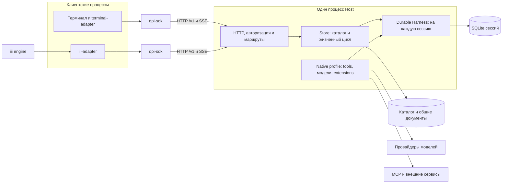
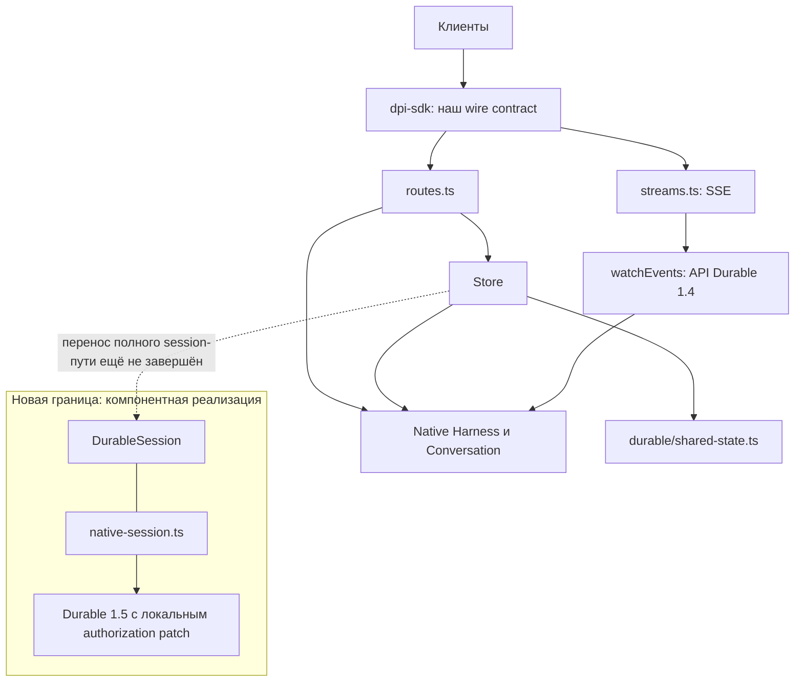
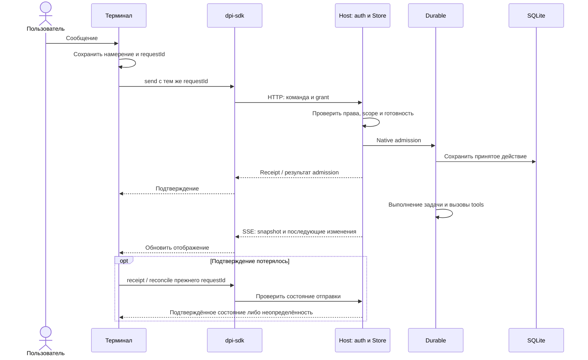
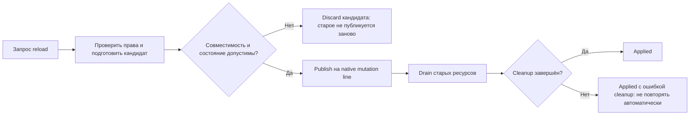

# Pi Durable Host: как проект устроен сейчас

**Одна папка для передачи проекта: текущий Host, карта изменений и вариант Zero.** Основная карта описывает код, а подкаталог `zero/` — отдельно помеченное предложение, не выполненную миграцию.

**Снимок исходников: 2 ноября 2026 года, 19:24:25 UTC**, commit `830ad61af22b1585f1358896f286acd40492c7ca`. Дополнение документации не меняет этот код и не подтверждает состояние запущенных служб.

> **Статус: разработка, не релиз.** Основной backend ещё закреплён на Durable **1.4.0**. Новый runtime-модуль и отдельная сборочная конфигурация **1.5.0** уже есть, но полный HTTP-путь на новую границу ещё не переведён. Нельзя считать этот снимок готовой заменой установленного Host.

## Быстрый вход для внешнего разработчика

| Вопрос | Документ |
|---|---|
| Как устроен Host и какие файлы менять? | **[MAP — карта текущего кода](MAP.md)** |
| Что осталось от Disler, что добавили и что патчили? | **[CHANGES — изменения и происхождение](CHANGES.md)** |
| Принимает ли наш fork картинки? Остался ли Express? | **[IMAGES-AND-HTTP — проверка по коду](IMAGES-AND-HTTP.md)** |
| Как перейти на неизменённый Zero? | **[Zero: OBSERVE → THINK → ARCHITECTURE](zero/README.md)** |
| Какие расширения куда переносить? | [Матрица расширений и будущих пакетов](zero/EXTENSIONS.md) |
| Что проверено и почему это не релиз? | [STATUS](STATUS.md), [Zero EVIDENCE](zero/EVIDENCE.md) |
| Как и что опубликовано? | [PUBLICATION](PUBLICATION.md) |

**Ссылка на весь пакет:** https://github.com/Diffuzmetall/pi-durable-host/tree/review/current-state-2026-11-02/docs/architecture

Ниже — обзор текущего Host с диаграммами. [Код backend](../../apps/dpi-backend/src) · [Корневой README](../../README.md).

## 1. Коротко

Pi Durable Host — серверная среда для агентных сессий. Терминал и другие клиенты отправляют команды через HTTP и получают изменения через SSE. Исполнение, задачи, история и восстановление принадлежат Durable внутри Host; SDK — клиентская библиотека, не отдельный сервер.

Один процесс Host может обслуживать несколько сессий. У каждой открытой сессии свой Harness и своё хранилище. Закрытие терминального окна не должно создавать нового владельца сессии или отменять уже принятую сервером работу.

### Процессы и внешние связи

На схеме iii engine и MCP-сервисы — отдельные внешние системы. Они не становятся вторым Durable-движком. Подключения зависят от настроенного профиля и прав; наличие интеграции в коде не доказывает доступность конкретного сервиса.

## 2. Где что находится

| Компонент | Ответственность | Исходники |
|---|---|---|
| Backend | HTTP-сервер, авторизация, каталог сессий, запуск и восстановление | [`apps/dpi-backend`](../../apps/dpi-backend) |
| SDK | Публичные типы, HTTP-клиент, SSE, обработка ответов и состояния | [`apps/dpi-sdk`](../../apps/dpi-sdk) |
| Терминальный адаптер | TUI, выбор модели и skills, черновик, журнал отправки, отображение состояния | [`apps/terminal-adapter`](../../apps/terminal-adapter) |
| iii-адаптер | Подписанные внешние вызовы к уже работающему Host | [`apps/iii-adapter`](../../apps/iii-adapter) |
| Native profile | Инструменты, подагенты, Goal, schedules, skills, memory, tracing и MCP | [`native-profile/profile.ts`](../../apps/dpi-backend/src/native-profile/profile.ts) |
| Reload | Подготовка и публикация совместимых моделей и расширений | [`packages/durable-reload`](../../packages/durable-reload) |
| Новый runtime-модуль | Семантические операции над сессией и адаптация native API | [`src/durable`](../../apps/dpi-backend/src/durable) — интеграция не закончена |
| BB-адаптер | Отложенное направление; присутствие кода не означает приёмку UI | [`apps/bb-adapter`](../../apps/bb-adapter) |
| Experiments | Сборочные сценарии, миграционные фикстуры и датированные отчёты | [`experiments`](../../experiments) |

`apps/dpi-tui`, playground и demo сохранены как унаследованные примеры. Это не основной operational installer данного Host.

## 3. Реальная граница кода — пока переходная

Нельзя нарисовать новый runtime-модуль как уже единственную связь между HTTP и Durable: это было бы неверно для опубликованного снимка.

**Что подтверждает код:**

- [`routes.ts`](../../apps/dpi-backend/src/routes.ts) импортирует `Conversation` и `Harness`, а маршруты получают native handles через Store.
- [`streams.ts`](../../apps/dpi-backend/src/streams.ts) импортирует и вызывает `watchEvents`, а также использует `subscribeCommits`.
- [`store.ts`](../../apps/dpi-backend/src/store.ts) по-прежнему содержит открытие Harness, конфигурацию, admission и native операции.
- [`shared-state.ts`](../../apps/dpi-backend/src/shared-state.ts) уже передаёт реализацию общих документов в `durable/shared-state.ts`.
- [`DurableSession`](../../apps/dpi-backend/src/durable/session.ts) определяет `send`, `receipt`, `reconcile`, `history`, `context`, `observe`, `configure`, `reload` и parent-control операции.
- [`native-session.ts`](../../apps/dpi-backend/src/durable/native-session.ts) реализует **часть** этого интерфейса через `Pick<DurableSession, …>`. Наличие файла не означает подключение всех методов к Host.

Цель переноса — скрыть меняющийся upstream API в одном владельце, а не добавить daemon, планировщик или универсальную систему плагинов. Подробный действующий план: [DM1](../host-design/hot-update/DURABLE-MODULE-PLAN.md).

## 4. Как проходит запрос

Это схема разделения ответственности, а не утверждение о полной приёмке всех ветвей. Подробности реализации находятся в [`idempotency.ts`](../../apps/dpi-backend/src/idempotency.ts), [`Store`](../../apps/dpi-backend/src/store.ts), [`remote-controller.ts`](../../apps/terminal-adapter/src/remote-controller.ts) и [`submission-journal.ts`](../../apps/terminal-adapter/src/submission-journal.ts).

Важные различия:

- **Принято** не значит **завершено**. Соединение может быть открыто, пока задача ещё выполняется.
- Потерянный ACK не разрешает отправить то же действие под новым ID. Сначала нужен receipt/reconcile.
- Отключение SSE закрывает наблюдение, а не даёт разрешение остановить native задачу.
- История разговора и контекст, выбранный для модели, — разные данные.
- Idempotency admission не гарантирует exactly-once для произвольного внешнего эффекта инструмента.

## 5. Кто владеет данными

| Данные | Владелец | Чего клиент не должен делать |
|---|---|---|
| Каталог сессий и метаданные | Store, `catalog.sqlite` | Менять строки напрямую |
| Общие документы устройства | SharedState, `app-state.sqlite` | Открывать native storage из адаптера |
| История, tasks, checkpoints сессии | Durable и session SQLite | Создавать второго владельца той же базы |
| Черновик и намерение отправки | Терминальный клиент | Считать локальную запись подтверждением сервера |
| Grants и проверка полномочий | Host | Передавать `source` или `authority` как самодостаточное разрешение |
| Provider credentials | Доверенная серверная конфигурация | Копировать секреты в SDK, README или клиентские bundles |

[`Store.openCatalog`](../../apps/dpi-backend/src/store.ts) открывает каталог и общие ресурсы, а сессии восстанавливает в фоне с ограниченной параллельностью. В коде есть состояния `restoring`, `ready`, `failed`, `closing`, `closed`; HTTP-слой не должен принимать мутации в неготовую сессию.

Границы прав применяются и к чтению: публичная проекция должна скрывать закрытые данные из snapshots и последующих изменений. Наличие sanitization в одном ответе не доказывает безопасность всех потоков; это отдельный предмет проверок.

## 6. Расширения и горячее обновление

Native profile собирает tools, модели, skills, memory, tracing, automation и MCP в существующем Harness. Конфигурация передаётся сервером; HTTP `/reload` не принимает произвольный путь к модулю от клиента.

Это механизм [`reloadDurable`](../../packages/durable-reload/src/index.ts): подготовка, проверка, синхронная публикация и последующее освобождение ресурсов. Для части resource/selection handoff нужен idle-барьер; обновление чистых definitions/provider snapshots не всегда требует остановки всей сессии.

**Три разные операции:**

1. Обновление клиента — новая версия терминала или SDK при совместимом протоколе.
2. Reload совместимых расширений — изменение зарегистрированных definitions и ресурсов внутри прежнего Host.
3. Обновление ядра Durable — отдельный проверяемый release и миграционный процесс. Этот снимок не обещает горячую замену ядра.

## 7. Версии и пределы совместимости

Основной [`package.json` backend](../../apps/dpi-backend/package.json) всё ещё закрепляет Durable, Chord, pi-ai, pi-codemode и pi-mcp на **1.4.0**. Отдельные [target manifests](../../experiments/durable-module-20261102/packaging/target-manifests) задают **1.5.0** для миграционного кандидата. Нельзя смешать эти две сборки и назвать результат принятым релизом.

Новый `native-session.ts` требует `COMMIT_AUTHORIZATION_REVISION = "host-commit-authorization-v1"`. Это **локальный патч 1.5**, а не неизменённый upstream-пакет; [основание и точная адаптация](../../experiments/durable-module-20261102/runtime/COMMIT-AUTHORIZATION.md) опубликованы отдельно.

`API_VERSION = 2`, URL `/v1` и версия Durable обозначают разные вещи. Совместимость определяется контрактом и capabilities, а не совпадением одной цифры.

**Остаётся проверить:** полный Host/SDK roundtrip на 1.5, один и тот же клиент против изолированных 1.4/1.5 сборок, совместимость сторонних компонентов, installed-package состав, shutdown/recovery и возврат к предыдущему release. Открытые ограничения перечислены в [STATUS.md](STATUS.md).

## 8. Как читать этот репозиторий

- Для знакомства начните с [карты файлов](MAP.md), [изменений относительно Disler](CHANGES.md) и [STATUS.md](STATUS.md).
- Для перехода на неизменённый Zero читайте [отдельный пакет исследования](zero/README.md). Внешняя композиция C — рекомендация для обсуждения, не окончательно выбранная или реализованная миграция.
- Для реализации смотрите ссылки на исходники: они ведут в ту же Git-ветку.
- Для целей проекта есть [ISA](../../ISA.md) и [план DM1](../host-design/hot-update/DURABLE-MODULE-PLAN.md).
- Для сравнения вариантов есть [архитектурная рекомендация R1](../host-design/runtime-architecture-20261102/ARCHITECTURE.md) и [HTML с иллюстрациями](../host-design/runtime-architecture-20261102/architecture.html). R1 — **предложение**, не описание уже законченного переноса.
- Отчёты в `experiments/` относятся к указанным там кандидатам. Локальные raw logs, приватные данные и сборочные каталоги не входят в публичный снимок.

**Не запускайте activation/restart/migration scripts из `experiments/` на рабочем Host для знакомства с проектом.** Просмотр кода и публикация ветки не разрешают такие операции.
