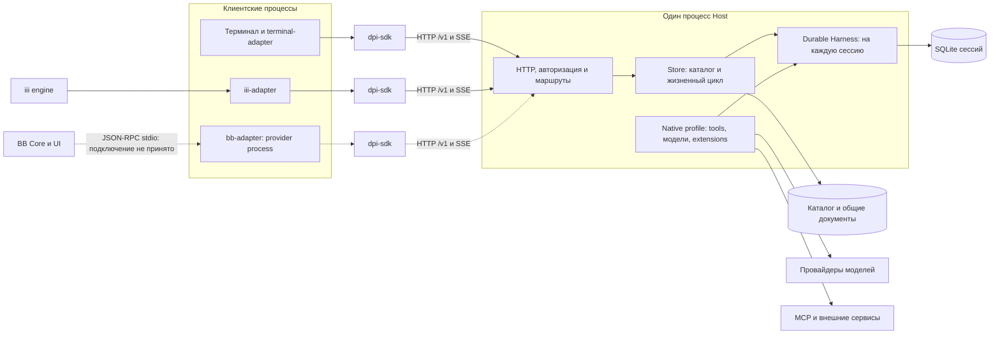
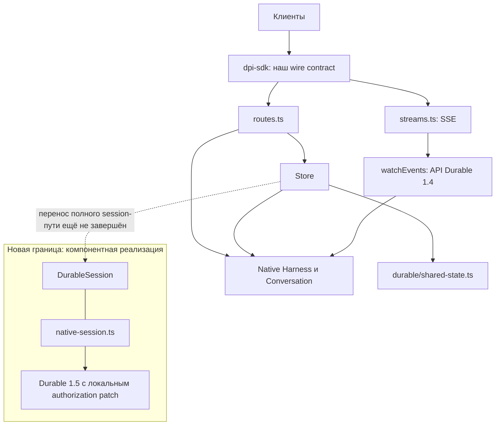
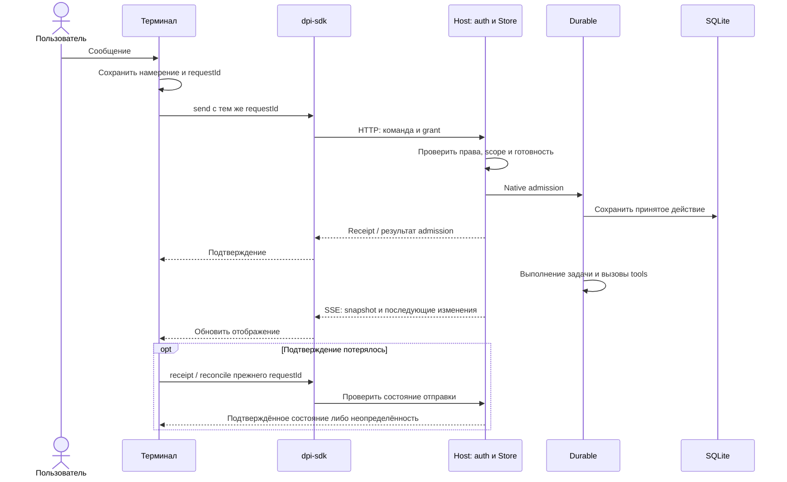
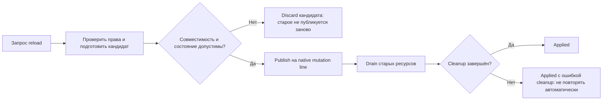

# Pi Durable Host: состояние проекта

Этот справочник описывает существующий Host, изменения относительно Disler и документы о варианте Zero. Подкаталог `zero/` содержит предложение, а не реализованную миграцию.

Снимок исходников создан 2 ноября 2026 года в 19:24:25 UTC, commit `830ad61af22b1585f1358896f286acd40492c7ca`. Дополнение документации не меняет этот код и не подтверждает состояние запущенных служб.

> Проект находится в разработке. Это не релиз. Основной backend использует Durable 1.4.0. Новый runtime-модуль и отдельная сборочная конфигурация 1.5.0 существуют, но полный HTTP-путь ещё не использует новую границу.
>
> Снимок нельзя считать готовой заменой установленного Host.

## Документы пакета

| Вопрос | Документ |
|---|---|
| Как устроен Host и где находятся его компоненты? | [MAP: карта текущего кода](MAP.md) |
| Что унаследовано от Disler, добавлено или изменено патчами? | [CHANGES: изменения и происхождение](CHANGES.md) |
| Принимает ли наш fork изображения и использует ли Express? | [IMAGES-AND-HTTP: выводы по исходникам](IMAGES-AND-HTTP.md) |
| Как устроено предложение перехода на неизменённый Zero? | [Zero: OBSERVE, THINK, ARCHITECTURE](zero/README.md) |
| Куда предлагается перенести расширения? | [Матрица расширений и будущих пакетов](zero/EXTENSIONS.md) |
| Как BB подключается без второго runtime? | [BB: provider adapter, SDK и Host](BB-ADAPTER.md) |
| Какой готовый backend выбрать и какие компоненты заимствовать? | [Сравнение семи кандидатов](host-options-20261102/README.md) |
| Что проверено и почему проект не готов к релизу? | [STATUS](STATUS.md), [Zero EVIDENCE](zero/EVIDENCE.md) |
| Как опубликован пакет? | [PUBLICATION](PUBLICATION.md) |

Весь пакет: https://github.com/Diffuzmetall/pi-durable-host/tree/review/current-state-2026-11-02/docs/architecture

Исходники: [backend](../../apps/dpi-backend/src), [корневой README](../../README.md).

## 1. Исполнение и клиенты

Pi Durable Host выполняет агентные сессии на сервере. Терминал и другие клиенты отправляют команды через HTTP и получают изменения через Server-Sent Events (SSE). Durable внутри Host владеет исполнением, задачами, историей и восстановлением. SDK является клиентской библиотекой, а не отдельным сервером.

Один процесс Host может обслуживать несколько сессий. У каждой открытой сессии свой Harness и своё хранилище. Закрытие терминала не должно создавать нового владельца сессии или отменять работу, которую сервер уже принял.

### Процессы и внешние связи

BB Core/UI, iii engine и MCP-сервисы являются внешними системами. Они не становятся вторым Durable-движком. Пунктир обозначает подготовленную, но непринятую интеграцию BB. Адаптер существует, однако полная интеграция с BB ещё не прошла приёмку.

Подключения зависят от профиля и прав. Наличие кода не доказывает доступность сервиса. BB запускает отдельный `dpi-bb-provider` и передаёт JSON-RPC через stdin/stdout. Адаптер обращается к существующему Host через SDK, не открывая Harness или session SQLite.

Настройки, привязка Root/children и ограничения описаны в [BB-ADAPTER.md](BB-ADAPTER.md).

## 2. Компоненты и исходники

| Компонент | Ответственность | Исходники |
|---|---|---|
| Backend | HTTP, авторизация, каталог сессий, запуск и восстановление | [`apps/dpi-backend`](../../apps/dpi-backend) |
| SDK | Публичные типы, HTTP-клиент, SSE, обработка ответов и состояния | [`apps/dpi-sdk`](../../apps/dpi-sdk) |
| Терминальный адаптер | TUI, выбор модели и skills, черновик, журнал отправки, отображение состояния | [`apps/terminal-adapter`](../../apps/terminal-adapter) |
| iii-адаптер | Подписанные внешние вызовы к работающему Host | [`apps/iii-adapter`](../../apps/iii-adapter) |
| Native profile | Инструменты, подагенты, Goal, schedules, skills, memory, tracing и MCP | [`native-profile/profile.ts`](../../apps/dpi-backend/src/native-profile/profile.ts) |
| Reload | Подготовка и публикация совместимых моделей и расширений | [`packages/durable-reload`](../../packages/durable-reload) |
| Новый runtime-модуль | Семантические операции сессии и адаптация native API; интеграция не завершена | [`src/durable`](../../apps/dpi-backend/src/durable) |
| BB-адаптер | Отложенное подключение BB; наличие кода не означает приёмку UI | [`apps/bb-adapter`](../../apps/bb-adapter) |
| Experiments | Сборочные сценарии, миграционные фикстуры и датированные отчёты | [`experiments`](../../experiments) |

`apps/dpi-tui`, playground и demo сохранены как унаследованные примеры. Они не являются основным установщиком operational-профиля Host.

## 3. Незавершённая граница runtime

Новый runtime-модуль ещё не является единственной связью между HTTP и Durable. Опубликованный снимок сохраняет прямые обращения к native API.

Исходники подтверждают следующие зависимости.

- [`routes.ts`](../../apps/dpi-backend/src/routes.ts) импортирует `Conversation` и `Harness`. Маршруты получают native handles через Store.
- [`streams.ts`](../../apps/dpi-backend/src/streams.ts) импортирует и вызывает `watchEvents`, а также использует `subscribeCommits`.
- [`store.ts`](../../apps/dpi-backend/src/store.ts) открывает Harness, выполняет конфигурацию, admission и native операции.
- [`shared-state.ts`](../../apps/dpi-backend/src/shared-state.ts) уже передаёт общие документы в `durable/shared-state.ts`.
- [`DurableSession`](../../apps/dpi-backend/src/durable/session.ts) определяет `send`, `receipt`, `reconcile`, `history`, `context`, `observe`, `configure`, `reload` и parent-control операции.
- [`native-session.ts`](../../apps/dpi-backend/src/durable/native-session.ts) реализует часть интерфейса через `Pick<DurableSession, …>`. Наличие файла не означает подключение всех методов к Host.

Перенос должен сосредоточить работу с меняющимся upstream API в одном модуле. Он не добавляет daemon, планировщик или универсальную систему плагинов. Работа описана в [плане DM1](../host-design/hot-update/DURABLE-MODULE-PLAN.md).

## 4. Путь запроса и подтверждения

Схема показывает разделение ответственности, но не подтверждает полную приёмку всех ветвей. Реализация находится в следующих файлах:

- [`idempotency.ts`](../../apps/dpi-backend/src/idempotency.ts);
- [`Store`](../../apps/dpi-backend/src/store.ts);
- [`remote-controller.ts`](../../apps/terminal-adapter/src/remote-controller.ts);
- [`submission-journal.ts`](../../apps/terminal-adapter/src/submission-journal.ts).

Принятие запроса и завершение задачи являются разными событиями. Соединение может оставаться открытым, пока задача выполняется. Потеря подтверждения (ACK) не разрешает отправить то же действие с новым ID. Сначала требуется `receipt` или `reconcile`.

Отключение SSE закрывает наблюдение. Оно не разрешает останавливать native задачу. История разговора отличается от контекста, который выбран для модели. Идемпотентный admission не гарантирует однократное выполнение произвольного внешнего эффекта инструмента.

## 5. Владельцы данных

| Данные | Владелец | Ограничение для клиента |
|---|---|---|
| Каталог сессий и метаданные | Store, `catalog.sqlite` | Клиент не меняет строки напрямую |
| Общие документы устройства | SharedState, `app-state.sqlite` | Адаптер не открывает native storage |
| История, tasks и checkpoints сессии | Durable и session SQLite | Клиент не создаёт второго владельца базы |
| Черновик и намерение отправки | Терминальный клиент | Локальная запись не является подтверждением сервера |
| Grants и проверка полномочий | Host | `source` или `authority` сами по себе не дают разрешения |
| Provider credentials | Доверенная серверная конфигурация | Секреты не копируются в SDK, README или клиентские bundles |

[`Store.openCatalog`](../../apps/dpi-backend/src/store.ts) открывает каталог и общие ресурсы. Сессии восстанавливаются в фоне с ограниченной параллельностью. Код содержит состояния `restoring`, `ready`, `failed`, `closing`, `closed`. HTTP-слой не должен принимать мутации для неготовой сессии.

Права ограничивают и чтение. Публичная проекция должна скрывать закрытые данные в snapshots и последующих изменениях. Очистка одного ответа не доказывает безопасность остальных потоков. Для них нужны отдельные проверки.

## 6. Расширения и reload

Native profile собирает tools, модели, skills, memory, tracing, automation и MCP в существующем Harness. Сервер передаёт конфигурацию. HTTP `/reload` не принимает от клиента произвольный путь к модулю.

[`reloadDurable`](../../packages/durable-reload/src/index.ts) подготавливает кандидат, проверяет его, синхронно публикует и затем освобождает старые ресурсы. Для части операций передачи ресурсов или выбора требуется idle-барьер. Обновление definitions или provider snapshots не всегда требует остановки всей сессии.

Следующие операции имеют разные границы.

1. Обновление клиента устанавливает новую версию терминала или SDK при совместимом протоколе.
2. Reload совместимых расширений меняет зарегистрированные definitions и ресурсы внутри прежнего Host.
3. Обновление ядра Durable требует отдельного проверяемого релиза и миграции. Снимок не обещает горячую замену ядра.

## 7. Версии и открытые проверки

Основной [manifest backend](../../apps/dpi-backend/package.json) закрепляет Durable, Chord, pi-ai, pi-codemode и pi-mcp на 1.4.0. Отдельные [target manifests](../../experiments/durable-module-20261102/packaging/target-manifests) задают 1.5.0 для миграционного кандидата. Смешение этих сборок не создаёт принятый релиз.

Новый `native-session.ts` требует `COMMIT_AUTHORIZATION_REVISION = "host-commit-authorization-v1"`. Это локальный патч 1.5, а не неизменённый upstream-пакет. [Основание и точная адаптация](../../experiments/durable-module-20261102/runtime/COMMIT-AUTHORIZATION.md) опубликованы отдельно.

`API_VERSION = 2`, URL `/v1` и версия Durable обозначают разные вещи. Совместимость определяется контрактом и capabilities, а не совпадением цифры.

Открыты следующие проверки:

- полный обмен Host и SDK на 1.5;
- один клиент против изолированных сборок 1.4 и 1.5;
- совместимость сторонних компонентов;
- состав установленных пакетов;
- shutdown, recovery и возврат к предыдущему релизу.

Остальные ограничения перечислены в [STATUS.md](STATUS.md).

## 8. Назначение остальных материалов

[MAP](MAP.md), [CHANGES](CHANGES.md) и [STATUS](STATUS.md) описывают текущий проект. [Пакет Zero](zero/README.md) описывает возможный переход. Внешняя композиция C остаётся рекомендацией для обсуждения, а не окончательно выбранной или реализованной миграцией.

Ссылки на исходники ведут в ту же Git-ветку. Цели проекта записаны в [ISA](../../ISA.md) и [плане DM1](../host-design/hot-update/DURABLE-MODULE-PLAN.md). [Архитектурная рекомендация R1](../host-design/runtime-architecture-20261102/ARCHITECTURE.md) и [HTML с иллюстрациями](../host-design/runtime-architecture-20261102/architecture.html) также являются предложением.

Отчёты в `experiments/` относятся к указанным кандидатам. Локальные raw logs, приватные данные и сборочные каталоги не входят в публичный снимок.

> Не запускайте activation/restart/migration scripts из `experiments/` на рабочем Host для знакомства с проектом. Просмотр кода и публикация ветки не разрешают эти операции.
