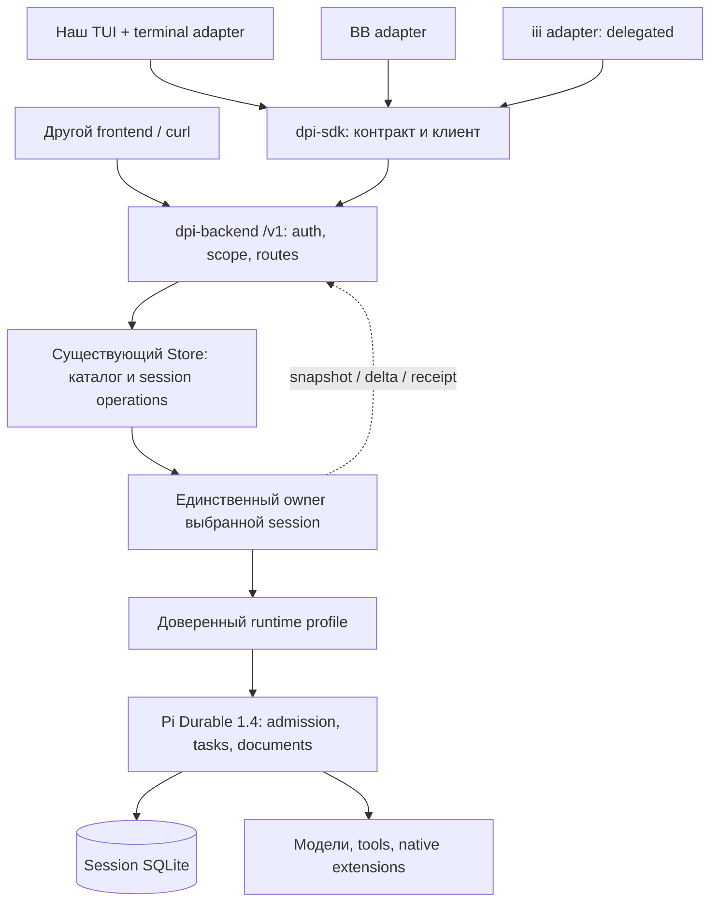
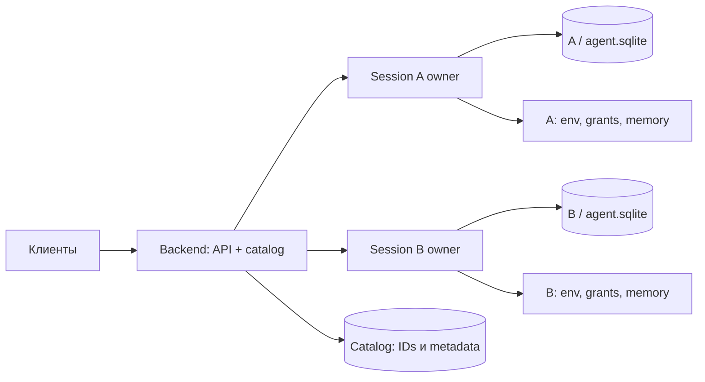
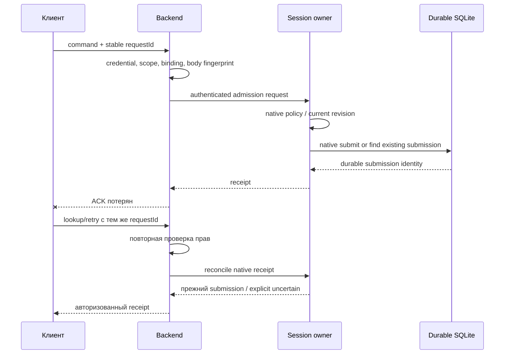

# Архитектура: один вход, существующий backend, отдельные клиенты

Статус: **PROPOSAL**, 2026-10-28. Кодовая основа уже существует, но показанные profile, scoped grants и adapters ещё предстоит реализовать. [Решения](THINK.md), [критерии](../../ISA.md), [этапы](PLAN.md).

## Готовые изображения

Схемы ниже отрисованы локально Mermaid CLI 11.4.2. Исходники Mermaid остаются в этом документе и в плане.

| Схема | Просмотр | Векторная версия |
|---|---|---|
| Логическая архитектура | [PNG](diagrams/architecture.png) | [SVG](diagrams/architecture.svg) |
| Владение sessions | [PNG](diagrams/ownership.png) | [SVG](diagrams/ownership.svg) |
| Admission и потерянный ACK | [PNG](diagrams/admission.png) | [SVG](diagrams/admission.svg) |
| Этапы внедрения | [PNG](diagrams/roadmap.png) | [SVG](diagrams/roadmap.svg) |

## Что увидит пользователь

Терминал подключается к URL host и выбирает session/conversation. В этом разговоре он видит прежние сообщения, текущие tools и запросы внимания. При отключении терминала host продолжает работу. BB позже открывает тот же conversation через свою проверенную thread binding. iii работает через отдельный delegated credential.

Права определяет host. Отдельный observer может видеть разрешённую работу, но не управляет ею. Ни один клиент не получает provider credentials или файловый путь к SQLite как способ управления.

## Логическая схема



Это схема ответственности, не утверждение о числе процессов. Backend не становится новым task runner. Durable исполняет задачи и восстанавливает их; Store управляет существованием и доступностью sessions.

### Где проходит граница процесса

P0 выбирает одну схему после проверки двух полных profiles. Вариант с отдельными session workers показан ниже, потому что у текущих integrations есть process-global настройки.



Если выбран worker, только он открывает session SQLite. Backend не открывает её для удобства чтения и не заменяет упавшего owner, пока прежний ещё может исполняться. Повторный owner требует освобождённого session lock. Смерть worker отражается как недоступность владельца, а не как успешное завершение задачи.

Workers получают доверенные server-side настройки, а не browser-selected module paths. IPC не публикуется наружу. Передаются ограниченные session operations и проекции, не произвольные методы Harness. Parent не принимает повторно уже принятую задачу ради восстановления worker.

Если P0 докажет локальную изоляцию paths/identity/dispatcher без большого переписывания dependencies, несколько owners могут остаться в одном процессе Disler. Тогда та же проверка двух sessions обязательна. Универсальный runtime-switch и поддержка двух режимов «на будущее» не нужны.

## Владение данными

| Данные | Кто владеет | Что видит клиент |
|---|---|---|
| Session catalog и profile reference | Существующий backend Store | Доступные summaries и стабильные IDs |
| Conversations, native tasks/documents, submission admission | Единственный session owner / Durable | Авторизованная projection, receipt, result |
| Provider credentials | Серверный model runtime | Только разрешённый список моделей и состояние доступности |
| Grants и binding revisions | Серверная policy и интеграция BB/iii | Выданный scoped credential, не возможность переписать policy |
| Editor draft, раскрытые панели, scroll | Конкретный клиент | Локальные настройки UI |
| RequestId до первой отправки | Отправляющий adapter | Стабильный key на retries той же операции |
| Результат принятия requestId | Native admission и связанный receipt | Прежний submission либо explicit uncertain/rejected |

Новый каталог receipts не копирует очередь Durable. Для создания session требуется durable intent/receipt, связанный с одним выделенным session ID. Если запись распределена между catalog и session DB, recovery должен довести один intent до результата или явного отказа. Обычный cache HTTP-ответов после операции эту задачу не решает.

## Приём команды и потерянный ответ

Сохраняется существующий endpoint `POST /v1/sessions/:s/agents/:a/messages`. Расширение его данных и receipt lookup проектируется в P1, без второй версии API на каждую интеграцию.



Durable commit означает принятие, а не завершение и не exactly-once внешнего API. Повтор с другим телом отклоняется. Значения actor/source/authority формирует host по credential, а не принимает на веру из JSON.

Отзыв grant закрывает уже открытые subscriptions этого grant и запрещает их дальнейшие защищённые emissions. Проверка scope только при HTTP connect недостаточна: после server-side revoke новые events не отправляются в этот stream. Уже переданные в транспорт байты отозвать нельзя; acceptance проверяет sentinel event, созданный строго после revoke.

В первом выпуске canonical request→result mappings **не имеют автоматического TTL**. TTL response-cache, включая нынешние 24 часа Disler, не ограничивает reconciliation по native receipt/сохранённому mapping. Удаление текста истории не удаляет эти ключи. При явном удалении ресурса сохраняется компактная tombstone для create key: retry возвращает `result-gone`, но не создаёт ресурс заново. Команды к удалённой session также отклоняются; клиент не создаёт новую session автоматически. Если canonical запись недоступна или повреждена, результат — unavailable/uncertain, не повтор эффекта. Garbage collection этих mappings требует отдельного будущего контракта; она не добавляется незаметно как housekeeping.

Если между HTTP check и queued admission изменились права, owning boundary отклоняет ещё не принятую команду. После принятия нельзя обещать отмену уже совершённого внешнего эффекта. Unsafe tool после crash следует native recovery semantics и не получает автоматический HTTP replay.

## Контракт клиента

`apps/dpi-sdk/src/api.ts` остаётся источником wire types. `GET /v1/device` уже существует; его совместимое расширение может объявлять protocol version и capabilities. Точный JSON закрепляется тестами P1, а не считается существующим по этой схеме.

Нужны следующие операции, преимущественно уже представленные в `/v1`:

- Узнать protocol/capabilities; получить разрешённые session/conversation summaries.
- Прочитать историю и открыть snapshot + live updates.
- Отправить сообщение с requestId; узнать его durable receipt и результат.
- Выполнить существующее interrupt/steer с нужными scope и native semantics.
- Прочитать доступные attention requests и ответить на разрешённый запрос.
- Прочитать ограниченные native artifacts/results в типизированной форме.

Не добавляются browser-доступ к Harness, прямой SQL, загрузка кода profile по HTTP и универсальный endpoint произвольного вызова native tool. Filesystem endpoints Disler тоже проходят scope-проверки; observer на один conversation не получает весь каталог host.

Capabilities объявляют операции и версии данных, а не имена внутренних классов. Отсутствующая обязательная capability блокирует действие с понятной причиной. Неизвестный render kind имеет text fallback. Обратная совместимость проверяется на зафиксированной паре версий, а не обещается для всех будущих релизов.

### Состояние работы не равно состоянию сети

Клиент различает три наблюдаемые вещи:

1. Исполнение: native queued/running/waiting/terminal state и его причина.
2. Доставку команды: accepted/rejected/uncertain, связанную с requestId.
3. Соединение: online/reconnecting/offline, с отметкой устаревшей projection.

Это представления существующих фактов, не три новых persisted state machines. Offline не делает задачу failed, а открытый SSE не доказывает принятие команды.

Reconnect получает свежий snapshot и продолжает stream. Исходные SSE IDs не трактуются как durable cursor. Snapshot и последующие deltas должны согласовываться по версии/порядку без окна потери commit. Slow viewer отсоединяется отдельно; execution owner продолжает работу.

## Что меняется в исходниках

| Owning file/package | Изменение | Что не делать |
|---|---|---|
| `dpi-backend/src/store.ts`, прежде всего `openAgent` | Подключить runtime profile; сохранить каталог и lifecycle | Новый backend с тем же набором методов |
| `dpi-backend/src/model-catalog.ts` и model routing в Store | Использовать поддерживаемый model runtime; убрать молчаливую замену моделей | Общий fallback на OpenRouter |
| `dpi-backend/src/auth.ts`, `routes.ts` | Scoped actor + проверки до side effects | Доверять `authority` из тела запроса |
| `dpi-backend/src/idempotency.ts`, native submit/create paths | Привязать retry к fingerprint и durable результату | Объявлять HTTP response cache exactly-once |
| `dpi-backend/src/streams.ts` | Сохранить streaming, добавить необходимые projections/capabilities | Заменять SSE брокером без требования |
| `dpi-sdk/src/api.ts`, `client.ts` и существующие reducers | Аддитивные wire types и reconciliation | Второй контракт, независимый от SDK |
| Наш terminal controller/view boundary | Remote controller поверх SDK при прежнем UI | Скопировать Disler TUI вместо нашего |
| Будущие BB/iii adapters | Перевести existing contracts в API host | Второй Harness в каждом adapter |

Process isolation затрагивает реальные `Harness`/`Conversation` references в Store и routes. Размер этой работы выясняется P0; её нельзя маскировать как единственный дополнительный аргумент factory.

## Пакеты и независимые обновления

Сохраняем upstream layout. Новые каталоги появляются только на этапе своего рабочего сценария:

```text
apps/dpi-backend/       существующий host, дорабатываем
apps/dpi-sdk/           существующий клиентский контракт
apps/dpi-tui/           upstream reference client, не наша замена TUI
apps/terminal-adapter/  будущая поставка нашего TUI + remote-controller
apps/bb-adapter/        будущая интеграция BB
apps/iii-adapter/       будущая интеграция iii
```

Profile сначала живёт в backend как явная composition factory. Выделение полного profile в отдельный пакет оправдано, когда его реально устанавливает наш pilot и минимальный backend без него уже работает. Не создаём заранее шесть пустых packages.

Каждый adapter указывает поддерживаемый protocol major и требуемые capabilities. Его release не меняет lockfile или binary другого adapter. Runtime extensions должны быть совместимы с SDK host; это другой контракт, не зависимость каждого frontend от Durable.

## Порядок запуска и закрытия

Запуск: validate config/profile → acquire owner lock → construct models/registry/env → проверить persisted definitions на разрешённой базе → bind native authority/integrations → resume → announce ready. Catalog нельзя считать источником доказательства, что owner уже готов.

Закрытие host: закрыть admission → дождаться или явно прервать принятые controller operations по native semantics → закрыть интеграции/Harness/resources → освободить lock. Закрытие клиента освобождает только его stream и subscriptions. Небезопасные инструменты после жёсткого сбоя могут требовать внимания; отсутствие дублей HTTP не устраняет эту неопределённость.

## Граница будущей миграции

Новые изолированные sessions проверяются первыми. Для выбранной старой session отдельно согласуются остановка owner, полный backup и кандидат. Candidate сначала работает только с разрешённой копией, с отключёнными или тестовыми внешними эффектами. Откат использует исходный backup с исходным runtime, а не попытку открыть уже мигрированную БД старой версией.

Пока не доказаны profile compatibility и session recovery, новая установка не заменяет production. Поддержка API не означает поддержку всех исторических task registries.
