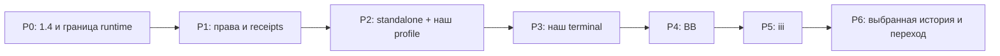

# План: основной маршрут backend + dpi-sdk + терминал + iii

## Текущий milestone: переход без BB

**Явное изменение scope пользователем:** довести backend + `dpi-sdk` + наш терминал + настоящий локальный iii до работающего перехода **при отсутствии BB**. Оно заменяет прежний порядок terminal → BB → iii для этого milestone, но не переписывает frozen ISA, исходные контракты или исторические результаты ниже. Архитектура остаётся прежней: один backend и native owner, клиенты через SDK; отдельный framework или второй runtime не создаются.

**BB отложен, не принят.** Его source-built Core `8afea059…`, результаты и незавершённые задачи сохраняются. Открытый UI-дефект с 25-секундным ожиданием не исправлен; он относится только к отложенной BB-приёмке и не блокирует основной маршрут. Новые BB/Core builds, bootstrap, Chrome-прогоны, timing diagnosis и BB fixes в этом milestone запрещены; уже запущенный ограниченный эксперимент завершается или checkpoint-ится его владельцем, затем освобождаются BB leases. Истечение lease не разрешает останавливать чужой процесс.

Публичный baseline — `Diffuzmetall/pi-durable-host`, commit `0c49efba7ef53ae20a22395ebdd1a4d9ea04fd44`. Локальный Store guard backend `9541d848…` независимо принят: copied catalog не открывает исходную SQLite через абсолютный путь или symlink до mkdir/lock/DB-open; сохранены canonical candidate и one-owner semantics. Этот пакет ещё не public-metadata-ready. Неизменённые зелёные проверки, включая 214-test baseline, повторно не запускаются; проверяются изменённые owning boundaries и реальный конечный маршрут.

Разрешена репетиция **одной уже выбранной неактивной сессии текущей launcher-selected Pi Durable 1.4.0** на защищённой копии. Snapshot и неизменность оригинала независимо проверены; повторный выбор/копирование истории не нужны. Это не доказывает импорт, совместимость, продолжение или rollback. Исходный `session.sqlite` не имеет host catalog/profile envelope; одинаковая версия SDK не доказывает совместимость сохранённых определений.

### Активные результаты на прежней доске DeLM

| Владелец | Результат | Зависимости текущего маршрута |
|---|---|---|
| Alice — `1b135743…` | Scope/план/status, затем необходимые coupled Store/profile/import/manifests repairs по точному контракту Bob; единственный public writer | Текущие исходники и approved scope, не BB |
| Bob — `88051168…` | Совместимость и импорт выбранной копии; сохранность IDs/history/state; контролируемое продолжение либо точный barrier | DONE snapshot `1034dbb6…`, DONE Store guard `fea830b2…` |
| Dave — `979a24c8…` | Независимые isolation/preservation/исходный rollback и четыре main-route пакета | Те же DONE outputs; static proof1164 переиспользуется |
| Carol — `02afc43c…` | Терминал + настоящий локальный iii без BB: canary сейчас, безопасный pilot clone после private handoff | DONE Store guard; Bob/Dave gates перед real-copy execution |

Старые `8ad3d57b…`, `af010781…`, `43707c9d…` сохраняют checkpoint/history, но не являются активным BB-gated путём этого milestone. Board v2 отклонил изменение unowned open task; новая явно scope-mapped ветвь на **той же доске** сохраняет fencing и не требует обхода guard или повторной реализации. BB `5945c980…`, `4f007ec8…`, `3d4dc10b…` остаются DEFERRED с неразрешённым техническим UI FAIL, не DONE. Состояние, claims, leases и свежие доказательства принадлежат доске.

### Готово для этого ограниченного маршрута, когда

1. Проверены **фактически сохранённые** task/doc/model/source-profile definitions до auto-resume; неизвестные/несовместимые definitions приводят к отказу. Отсутствующий исходный formal profile ID не заменяется выдуманным; model IDs не меняются молча.
2. Импорт сохраняет native IDs, историю, задачи, документы, children и pending-state. Пустой новый conversation не считается переносом.
3. Контролируемое продолжение действительно проверено без повторения старых действий и без model remap. Static inspection и simulated continuation помечаются отдельно и не дают GO. Обнаруженный отказ известной модели из-за отсутствия credentials — реальный operational barrier, а не повод подключить live provider или подменить модель.
4. Терминал и настоящий локальный iii работают через один backend **без BB**, включая существенные reconnect/interrupt/recovery, authenticated retry/ACK-loss и no-replay сценарии. Generated canary не подменяет real-copy proof.
5. Проверен возврат на отдельной restore-копии из **нетронутого оригинального backup** с точным исходным runtime/profile. Старый runtime не открывает upgraded candidate DB.
6. Независимые evidence и sanitized docs связывают точный source→target/candidate/команды/результаты и ограничения. Scoped outgoing review предшествует Alice commit/push только в `Diffuzmetall/pi-durable-host` main; deploy/activation не разрешены.

**Текущий verdict: NO-GO для рабочего перехода**, пока эти критерии не закрыты. Один pilot PASS не означает поддержку всех исторических версий или production readiness. Candidate sandbox не видит оригинальные пути, credentials и внешнюю сеть; HOME/config свежие, ресурсы ограничены, опасные сохранённые эффекты заблокированы. Оригиналы, владельцы, installed runtime и production не меняются; нет live моделей/API, личных memory banks или экспорта private payload. Bob владеет выбранной копией/импортом, Dave — независимой проверкой; в документах/доске только разрешённые locators, counts/hashes/outcomes, не raw transcripts/секреты.

## Исторический срез P0–P5 (не текущая migration acceptance)

Дата исходного плана: 2026-10-28. Исторический срез: 2026-10-29. Локальные P0–P5 выполнялись в порядке terminal → BB → iii с Disler backend/SDK/native1.4. Тогда реальные данные не были разрешены; это ограничение заменено выше только для одной выбранной copy rehearsal, не для production. Следующие строки сохраняют прежние evidence и не объявляют отложенный BB принятым в текущем scope.

### Исторический остаток ISA

**51 PASS / 2 PARTIAL / 0 UNKNOWN / 0 FAIL.** Только ISC-39/40 остаются частичными: выбранная историческая session и исходная historical/cross-version restoration не проверены. Running-BB UI smoke требуется перед production replacement; BB `/compact` unsupported до effect/ACK. Это не human project acceptance или произвольная native plugin compatibility.

Единый final tuple: backend `1df78d0f…`, SDK `35105485…`, terminal `1f1b74fa…`, BB `01210a7d…`, iii `75da7623…`; 407 source files + все восемь lockfiles. Пять strict checks, полные193/193 без skips, реальные installed native signed/HTTP/security15/default-CLI/curl/standalone/mixed-version проверки. [Финальный report](verification/final-p5/REPORT.md) содержит полные SHA/команды/author exclusions; [повторное итоговое ревью](verification/post-final-review/REPORT.md) подтверждает identity/evidence closure и свежие пять typechecks без ложного повторного runtime verdict.

Один writer текущей canonical сверки — Alice, fenced `dc40e1f9…`, отдельная узкая lease. Frozen ISA ID/text/order и 53 шестиколоночные строки Test Strategy/thresholds не изменены. Ниже каждый leaf учитывается ровно один раз; PASS относится к указанному локальному scope.

| Leaf | Статус | Коррелированное evidence / граница |
|---|---|---|
| ISC-1 | PASS | B P0 owner exclusion; second owner cannot resume; earlier independent P0 review retained. |
| ISC-2 | PASS | Installed compiled security 15/15 + B provider/SSE/opaque projection; independent combined Carol762 and Bob742 corrected-source scopes, explicit P1 resolutions. |
| ISC-3 | PASS | B auth-http observer mutation negatives + installed route/auth regression. |
| ISC-4 | PASS | B configured native/delegated and Goal negatives; installed signed iii + native HTTP; Dave807 nonauthor client signature/canonical evidence. |
| ISC-5.1 | PASS | B revoke/read reconnect; installed auth routes and native iii denied after revoke. |
| ISC-5.2 | PASS | B queued native admission/revoke; installed native iii late awaited native-Tx rollback proves no committed job/request after denial. |
| ISC-5.3 | PASS | Actual open SSE → revoke → later committed sentinel exclusion in B and installed auth batch; independent authorized reader remains usable. |
| ISC-6 | PASS | Strengthened B P0 actual persisted native model equality/no resume; configured native Models preserves unavailable exact references. |
| ISC-7 | PASS | B incompatible persisted profile before factory/resume; async binding cleanup; installed iii trusted identity mismatch before native resume. |
| ISC-8 | PASS | Fresh three independent client installs, archive byte closure, 49/16/6 runtime modules; no native runtime/storage/backend imports or nonliteral module loads. |
| ISC-9 | PASS | Fresh installed actual default minimal CLI with empty HOME and faux, no private integration/profile; literal curl work and owner reopen. |
| ISC-10 | PASS | B actual 1.4 SIGKILL/native tool roundtrip; fresh installed BB 50 actual native reads and terminal/BB mixed native answers. |
| ISC-11 | PASS | B alternate trusted registry/profile integration without backend/SDK modification; installed configured native iii profile uses public composition seam. |
| ISC-12 | PASS | B actual composed native DCG missing/deny recording environment; independent native gate 5bfaf889, no dangerous fixture shell effect. |
| ISC-13 | PASS | B actual nested native CodeMode rechecks each MCP effect, including revoke; independent native gate retained. |
| ISC-14.1 | PASS | Fresh B two actual native Hindsight/Mail sessions and reload/fork probes; independent Dave memory successor gate d7edb43f. |
| ISC-14.2 | PASS | Same native A/B log/usage/diagnostic path/content assertions; independent memory successor proof, no personal banks. |
| ISC-15 | PASS | B actual schedule restart: same native task/doc/request IDs, one accepted occurrence; independent native automation proof. |
| ISC-16.1 | PASS | B copied registered native definitions reopen same child/task/canonical IDs; independent native gate. |
| ISC-16.2 | PASS | B schedule/delegated/parent native documents reopen unchanged; installed iii JobScope/Journal/control/result identities survive owner reopen. |
| ISC-17 | PASS | S/T unknown-kind fallback; prior independent actual installed terminal safe text on identical terminal bytes. |
| ISC-42 | PASS | B actual Goal service rejects model/delegated self-approval; human pending remains; independent native automation + terminal Goal evidence. |
| ISC-43 | PASS | B actual local recording MCP two-session identities/grants/close isolation; independent Dave memory successor proof. |
| ISC-44 | PASS | B configured single registry executes original agreed tool families through native Models/loopback and scoped skills/context; independent native/memory inventory gates. |
| ISC-18.1 | PASS | Prior independent terminal multiline editor PTY 8/8 on identical 1f1b74fa archive; fresh T/controller/mixed-host seam. |
| ISC-18.2 | PASS | Prior original tool-card partial→final PTY + installed native/DCG stream; byte-identical terminal; fresh T/native host regressions. |
| ISC-18.3 | PASS | Prior independent chosen conversation/child/main/session/new/reconnect PTY 8/8, identical archive; fresh controller tests. |
| ISC-19.1 | PASS | Prior PTY child Escape returns without abort, root Escape actual native interrupt; fresh native controller/source T coverage. |
| ISC-19.2 | PASS | Prior stronger busy-steer PTY 9/9 actual native tool and SSE inbox mode=steer; same terminal/controller bytes. |
| ISC-20 | PASS | Installed signed/native HTTP run waiter disconnect leaves accepted work running; prior last-TUI-close proof; native late result after reopen. |
| ISC-21 | PASS | S/T reconnect snapshot/delta convergence and dedup; prior installed projection 2/2; fresh mixed same native conversation. |
| ISC-22 | PASS | T actual native pending attention/Goal owner/viewer reopen; prior independent installed native terminal proof with no default answer. |
| ISC-23 | PASS | B real HTTP/native commit ACK loss, same IDs after retry/reopen; installed signed/native iii actual dropped socket ACK. |
| ISC-45 | PASS | B actual 25-hour cache advance + native reconcile/reopen; canonical maps do not rely on response cache; iii saved receipt survives owner reopen. |
| ISC-24 | PASS | B concurrent body/whenBusy conflicts; installed native/signed iii changed body/mode 409; no metadata authority; reserved key denied with zero effects. |
| ISC-25 | PASS | B concurrent create/fork preallocated identity and genuine crash/reconcile cases; unchanged canonical create semantics; installed minimal stable session retry/reopen. |
| ISC-26 | PASS | Current installed BB 50 actual native read commits p95 49.123057 ≤ 50.0603852 ms; prior identical terminal PTY p95 4.278373 ≤ 51.9471548 ms; exact scopes above. |
| ISC-27 | PASS | B real stalled TCP SSE viewer bounded-disconnect, second client native completion; prior independent slow-viewer proof retained. |
| ISC-28 | PASS | BB + installed current native-read/bridge flow root/thread/provider/CWD and scoped Models negatives; prior independent BB616. |
| ISC-29 | PASS | BB native input/retryContext/history CAS/digest/lost-ACK/reopen assertions; prior independent installed BB616 on identical BB bytes, fresh B transport. |
| ISC-30 | PASS | B real native parent/child control, exact execution/revision/outcome and pending-stop; BB existing-child controls/history; installed current BB child survives root view release. |
| ISC-31 | PASS | Fresh mixed old SDK/unchanged accepted terminal + current SDK/BB, SAME final host/session/conversation and actual native answers; archive-exact closures. |
| ISC-32 | PASS | Installed signed CLI and full native HTTP concurrent/retry/ACK-loss/reopen preserve one native job/submission/generation; Dave807 independent client Admission proof. |
| ISC-33.1 | PASS | Installed actual native parent controls deny foreign binding/same-session job/child/execution; no client metadata or generic abort authority. |
| ISC-33.2 | PASS | Installed actual current revision/generation checks reject stale native parent control; pending stop is not reported as completed effect. |
| ISC-34 | PASS | Installed actual late accepted work completes after owner/client reopen; same durable native answerRef/SHA/Unicode pages; ephemeral cursor correctly resets/conflicts. |
| ISC-35 | PASS | Public installed TS SDK recipe earlier executed with identical SDK351 package; fresh installed pure SDK terminal/BB/iii consumers and actual declarations; no Durable imports in SDK. |
| ISC-36 | PASS | Fresh literal unchanged curl create/submit/receipt/result recipe three times across two actual installed default CLI owner opens. |
| ISC-37 | PASS | S incompatible version/capability/legacy zero-mutation assertions; fresh old/current SDK mixed native answer validates compatible path. |
| ISC-38 | PASS | Fresh empty offline terminal-only, BB-only, iii-only installs with actual immutable SDK25; each omits two other adapters/backend/native runtime and matches its archive bytes. |
| ISC-39 | PARTIAL | Existing DONE5ce22 disposable closed-owner same-version copy rehearsal/runbook only. No actual selected historical or cross-version data transition authorized/tested. |
| ISC-40 | PARTIAL | Same disposable offline backup/restore rehearsal only; original historical runtime/version restoration and production running-BB smoke remain NOT_TESTED. |
| ISC-41 | PASS | All five archive/installed upstream MIT/copyright notices preserved; original source hashes distinguished from local derived hashes; user explicitly confirmed iii MIT rights. |

## Поставка после приёмки

- Final gate `2d92aad6…` DONE816; requested repeat review `99fa4c40…` DONE823.
- Текущий `dc40e1f9…`: Alice синхронизирует отдельно разрешённый public checkout и переписывает README/guides/status/prompts; не переносит private reports, keys, session data или machine paths.
- Затем существующий независимый outgoing review `67b89ef1…`, после его DONE — Alice `e6691b5b…` для exact staged inventory/commit/push/readback в существующий отдельный GitHub repo.
- Первоначальный публичный checkpoint `3611d408…` уже доставлен; финальные docs/commit/push не считаются выполненными этим планом.
- Никаких новых workers, paid/live моделей, npm release, deployment, реальной миграции или production activation по этим результатам.

## Как использовать план

Детальная P0–P6 раскладка ниже сохраняет исходный порядок как историю проектирования. Для текущей работы действует верхний milestone **без BB**: BB не является prerequisite терминала, iii или выбранной migration rehearsal. Независимые fixtures можно готовить параллельно, не выдавая их за закрытую migration acceptance. Каждый milestone завершается работающим сценарием и проверкой, а не каталогом заготовок. Исполнитель читает исходники перед правкой и сохраняет несвязанные изменения. Имена acceptance cases в ISA пока обозначают необходимые проверки, не уже существующие тесты.

Для кодового этапа сначала воспроизводится его отсутствующее поведение на изолированной fixture, затем меняется owning module. Product gates проверяются на итоговых файлах. Независимые review/QA нужны на завершённых пользовательских milestones, не после каждого маленького edit.

Практический приоритет — P0. Если 1.4, session ownership или сохранённые definitions не проходят, не наращиваем UI поверх этого ограничения.

## Начало работы четырёх DeLM-агентов

Первый actor создаёт на доске только недостающие полезные задачи, затем сам реализует одну из них. Это не отдельная должность координатора и не требование сначала составить полный DAG. Остальные читают свежую доску, берут доступные задачи и не дублируют занятые пути. Конкретные IDs и ownership принадлежат доске, а не этой таблице.

| Начальный результат | Граница записи | Что позволяет начать |
|---|---|---|
| Работающий SDK 1.4 roundtrip и runtime composition | Один владелец manifests/lockfiles, `apps/dpi-backend/src/store.ts`, profile/model implementation | Baseline Disler и существующие faux tests |
| Regression fixtures для ownership, models и crash/retry | Отдельные новые test-файлы; существующие shared fixtures только после handoff | Публичный API baseline; для acceptance нужен кандидат первого потока |
| Проверка process-global изоляции | `experiments/session-isolation/` только в этом fork; копии/локальные fixtures, не production integrations | Source map OBSERVE; результат нужен для process-layout решения |
| Зафиксированное поведение нашего TUI и remote-controller seam | `docs/host-design/terminal-baseline/` и изолированные UI fixtures | Чтение выбранного TUI; никаких правок установленного release |

Первый actor уточняет эти границы по исходникам. Это стартовая раскладка полезных outputs, не обязательные четыре больших задачи и не разрешение обходить критерии. Coupled runtime/Store изменения остаются у одного владельца; tests могут начинаться до API patch и быть красными, если причина связана с будущим изменением. Общие package scripts/lockfiles меняет их владелец после явного board handoff.

Работают ровно четыре разрешённых участника: GPT-6.1 Sol, medium. Новых моделей/дочерних агентов не запускают; независимые проверки milestones выполняют другие участники этой же четвёрки. Доска DeLM — источник задач, зависимостей, leases и evidence. Пустую работу ради заполнения панелей не создают; свободный actor использует native `delm_wait(action=work)`.

## P0. Один реальный разговор на 1.4 и решение об изоляции

**Результат:** существующий API Disler обслуживает новую временную session на Durable 1.4 с faux; зафиксировано, как безопасно размещать наш profile.

1. Прочитать backend/SDK package manifests и existing tests. Изменить SDK pins и lockfiles только в кандидатном checkout. Не трогать installed releases.
2. Добиться `check` и существующего faux HTTP/tool/restart сценария на 1.4. Не скрывать несовместимость через `any`, `ts-ignore` или понижение требований проверки.
3. Выделить локальную profile factory у `Store.openAgent`. Сначала сохранить остальной Store. Вынести demo playground/jobs из обязательной конфигурации нового минимального profile, не удаляя чужие demos из репозитория.
4. Запретить silent model remapping для нового profile. Проверить сохранённый model ID, отсутствующую модель и ясную ошибку до первого model call.
5. Сопоставить direct Harness/Conversation consumers в Store/routes/streams. Сравнить узкое устранение process globals с session process. Сделать минимальную двухсессионную fixture на копиях integrations: разные cwd, log paths, Mail identities, независимый close.
6. Зафиксировать один выбранный process layout и затронутые файлы. Если worker необходим, определить только операции, действительно вызываемые routes/SDK. Не создавать proxy всего Harness.

**Проверки:** ISC-1, ISC-6, ISC-10; probes ISC-14/43 для решения об изоляции. Запустить concurrent owner попытку и kill/restart на временных БД. Нельзя считать successful compile доказательством recovery.

**Ожидаемые файлы:** `apps/dpi-backend/package.json`, lockfile, `src/store.ts`, `src/model-catalog.ts`, один composition module при необходимости, existing tests. Если process isolation требует дополнительной session-operation границы, её размер должен быть виден в diff, а не спрятан в новом framework.

**Остановка этапа:** неподтверждённая изоляция допускает только помеченный single-session pilot. Для дальнейшего выпуска нескольких sessions требуется доказанный вариант. Невозможность переноса конкретной native API записывается как blocker с точным source/test, не повод самовольно сменить основу.

## P1. Команда не получает лишних прав и не дублируется

**Результат:** два независимых HTTP-клиента управляют одним conversation через authenticated admission; observer только читает.

1. Привязать credential к actor, scope и session/conversation binding. Оставить bearer transport; не придумывать собственную криптографию. Правила iii signature/grants сохранить в его boundary.
2. Проверять все read/write routes, включая history, filesystem, task abort и расширения. Авторизацию делать до чтения чужих данных и до side effects. Revoke закрывает активные streams; отдельный тест создаёт event после revoke и проверяет, что прежний stream его не получил.
3. Передавать stable requestId и actor в native admission. Не использовать неизменённый terminal `humanSubmit` для iii.
4. Связать fingerprint и native submission identity. Добавить lookup/reconcile для потерянного ACK. Проверять текущие права и при повторном чтении receipt. Canonical mappings не имеют автоматического TTL; очистка response-cache не очищает их. Проверить retry после нынешнего 24-часового cache horizon; при явном удалении ресурса сохранить tombstone и вернуть result-gone, не новое исполнение.
5. Исправить create-route idempotence: заранее выделенный resource ID и durable intent/receipt с восстановлением после crash. Не решать это только mutex или cache ответа после создания.
6. Добавить protocol/capability discovery в существующий контракт. Зафиксировать snapshot/delta ordering, reconnect и slow-viewer policy.

**Fault matrix:** сбой до admission; после native commit до ответа; конкурентный retry; тот же key с другим payload; revocation между request check и admission; restart при незавершённом create intent. Для unsafe внешнего эффекта допустим explicit uncertain, не автоматическое повторение.

**Проверки:** ISC-2–5 (включая ISC-5.3), ISC-17, ISC-20–25, ISC-27, ISC-37, ISC-45. Fixture должна видеть прежний submission ID, а не только одинаковый текст ответа. Catalog reconciliation проверяется количеством созданных ресурсов и родительскими связями.

**Ожидаемые файлы:** `auth.ts`, `routes.ts`, `idempotency.ts`, Store admission/create methods, `streams.ts`, `dpi-sdk/src/api.ts`, `client.ts`, соответствующие tests. Вторая очередь задач не создаётся.

## P2. Чистая установка и наш полный profile

**Результат:** minimal host работает без частных интеграций, наш profile подключается отдельно и проходит согласованные проверки.

1. Упаковать minimal backend и SDK в локальные tarballs. Установить в временный HOME без зависимостей от `master/experiments` и авторских absolute paths.
2. Подключить две profile fixtures без изменения backend: минимальную и альтернативную с одной native extension. Они доказывают seam, а не универсальность любых SDK.
3. Перенести наш composition код вместе с его явными зависимостями и licenses. Отделить native authority/lifecycle от Hindsight, сохранив порядок bind/resume/close. Не переносить весь production release как скрытую зависимость.
4. Проверить guards, MCP/CodeMode и profile inventory. Для web/Context7/Codex/Antigravity использовать локальные recording fixtures; наличие credentials на VPS не является install requirement.
5. Проверить Hindsight и Mail в двух sessions. Для Hindsight использовать тестовый endpoint/fixture, не писать в личные memory banks. Проверить schedules, native subagents/Goal и persisted task/document compatibility.
6. Дать два реально исполняемых примера: TS SDK и HTTP без SDK. Они создают временный conversation, отправляют работу и читают её итог.

**Проверки:** ISC-7–9, ISC-11–16, ISC-35/36, ISC-41–44. Проверить dependency graph packed artifacts: клиент не приносит server SQLite/Harness и чужие adapters.

**Ожидаемые файлы:** composition module/profile, package manifests, install/example docs и tests. Отдельный profile package появляется только если его отделение действительно нужно установленному пилоту.

**Не требуется:** здоровый Hindsight/Timeweb/другой внешний сервис для прохождения минимального install. Для конкретной optional integration unavailable должно быть явным, а не замаскированным.

## P3. Наш TUI становится удалённым клиентом

**Результат:** пользователь работает привычным TUI; execution переживает его закрытие.

1. Зафиксировать текущие TUI fixtures: editor, streaming tools, transcript/navigation, выбор session и существующие interrupt/steer. Не принимать предложенную ассистентом новую кнопку Stop за требование.
2. Реализовать remote-controller в существующей controller/view границе через `dpi-sdk`. TUI больше не создаёт Harness и не закрывает session owner при exit.
3. Показать reconnect/offline отдельно от native execution state. Reconcile snapshot и deltas без дублей. Pending attention показывается после reconnect и не отвечает сам на себя.
4. Упаковать terminal adapter отдельно от BB/iii. Upstream `dpi-tui` оставить reference fixture; не подменять им наш интерфейс.
5. Прогнать сценарий: submit в TUI → закрыть TUI → прочитать результат через независимый API-клиент → подключить TUI обратно к тому же conversation.
6. Измерить synthetic commit→render latency на том же fixture до и после смены transport. Отделить model latency от transport latency. Провести независимые review и terminal QA этого milestone.

**Проверки:** ISC-18–22, ISC-26/27 и terminal часть ISC-38. Прогон UI обязан проверять реальное взаимодействие, а не только TypeScript.

**Не расширять:** новый редактор, новый theme engine, полноценный web-продукт, глобальный поиск по всем машинам.

## P4. BB подключается без второго runtime

**Результат:** BB thread отображает привязанный разговор; children и история сохраняют текущую семантику.

1. Взять binding/admission/history logic из действующего `projection/host/session.ts` пути, а не legacy provider host.
2. Заменить transport на SDK, сохранив root/child authority и readiness. Передавать стабильный clientRequestId и для root, где сейчас он теряется.
3. Сохранить историю с authorized digest/CAS и идентичным lost-ACK retry. Отказ reconnect не превращать в создание новой session или child promotion.
4. Подключить native parent-control, поздние результаты и terminal outcomes. Запрещённая команда не должна попасть в generic task-abort обходным путём.
5. Обновить только пакет BB adapter и проверить ранее собранный terminal artifact с тем же host. Провести независимые review и BB QA milestone.

**Проверки:** ISC-28–31, BB часть ISC-26/38; повтор security/receipt fixture только там, где adapter меняет mapping. BB API fixture годится для разработки; production replacement требует реального isolated BB smoke на выбранной совместимой версии.

## P5. iii получает delegated admission и durable результат

**Результат:** iii job исполняется в том же host с ограниченными правами и корректной повторной доставкой.

1. Сохранить namespace/config/session binding, fingerprint и stable job request key.
2. Привязать проверенную iii identity к server grant. Не принимать caller worker ID за identity и не повышать `source:iii` до human.
3. Reconcile по native submission/receipt. Не путать tree invalidation cursor, process-local pagination cursor и immutable answerRef.
4. Использовать установленную native parent-control capability, policy revision и pending-stop reconciliation.
5. Проверить delayed result после потери соединения и restart. Установить iii adapter без terminal/BB. Провести независимые review и iii QA milestone.

**Проверки:** ISC-32–34, iii часть ISC-38; негативные scope/policy fixtures ISC-4/5/33.

## P6. Выбранная старая session и подготовка перехода

**Результат:** разрешённая копия конкретной session продолжает работу на candidate; возврат отрепетирован. Это ещё не автоматическое переключение production.

1. До доступа к рабочим данным согласовать конкретную session, полный backup, остановку её owner и окно переключения. Нельзя безопасно копировать активную SQLite обычным `cp` и считать snapshot согласованным.
2. Зафиксировать исходный runtime/profile/task definitions, model references и data files. Создать согласованный backup только разрешённым способом.
3. Сначала открыть копию в изолированной среде. Заменить опасные внешние эффекты тестовыми endpoints либо оставить работу заблокированной; никакой silent replay.
4. Проверить continuation, native children, pending attention и отсутствие model remapping. Несовместимый profile должен отказаться до resume.
5. Восстановить исходную копию исходным runtime. После односторонней миграции откат выполняется из backup, не downgrade поверх изменённой SQLite.
6. Подготовить runbook с точными командами для выбранной установки. Production activation, публикация пакетов и push требуют отдельной авторизации и не запускаются из этого плана автоматически.

**Проверки:** ISC-39/40 и соответствующие safety/recovery критерии. Если конкретная историческая session несовместима, задокументировать причину и поддерживаемый набор; не объявлять весь архив переносимым.

## Исходный критерий остановки и разрешения (история)

Текущие разрешения и ограниченная real-copy rehearsal описаны в начале плана; следующие строки — первоначальные границы, не отменяющие явное последующее согласие пользователя.

На старте пользователь явно разрешил после повторного doc review начать локальную реализацию кандидата четырьмя DeLM-агентами. Разрешены P0–P5 с изолированными проверками и подготовка безопасного runbook P6. Это не разрешает production-переход: P6 с реальными session data ждёт отдельного согласования конкретных данных и действий. Обычные обратимые правки кандидата и изолированные тесты не требуют согласования каждой команды.

Отдельные разрешения нужны для работы с production data, остановки сервиса, переключения runtime, платных API вне согласованного доступа, publication/push/deploy. Нельзя удалять или менять production dependencies под `master/experiments/**`, особенно `release/` и `prepared/`.

## Проверка самого пакета проектирования

- ISA имеет одну claim layout, стабильные IDs и одну строку Test Strategy на каждый leaf.
- Каждый этап привязан к проверяемому пользовательскому результату и owning files.
- Отдельно обозначены SOURCE, TEST и будущие capabilities; нет заявления о реализованном 1.4 host.
- Ссылки разрешаются; схемы не дают клиентам ownership БД или обход authority.
- Независимый reviewer проверяет scope, reuse, claims и незакрытые риски. Итог записывается в [REVIEW](REVIEW.md).
