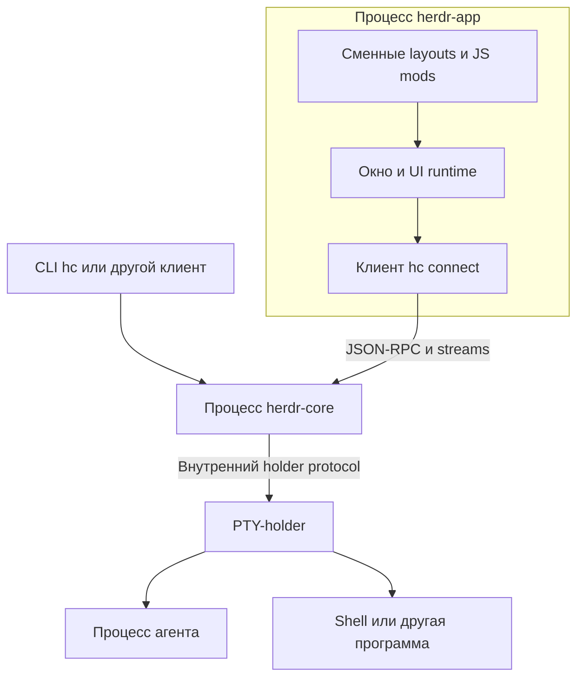
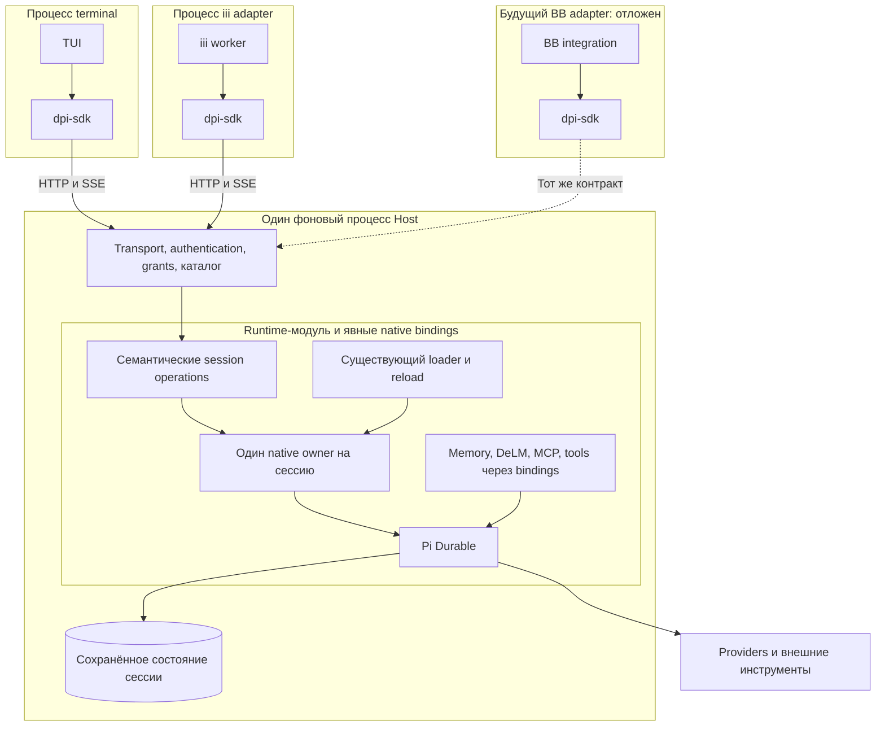
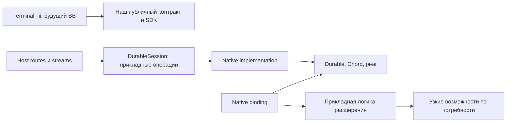
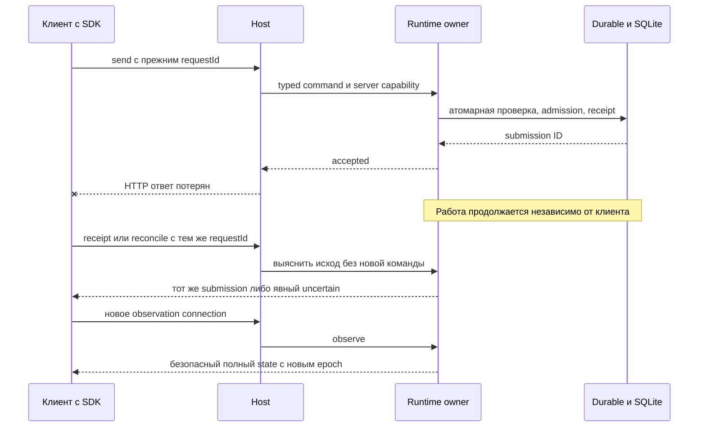
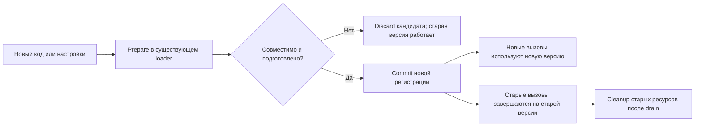
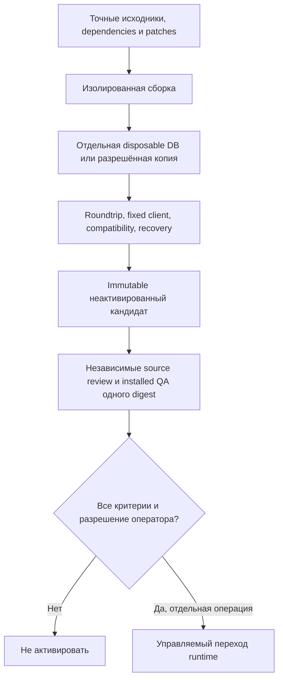

# Durable Host: независимые клиенты и расширения вокруг одного движка

Архитектурная рекомендация · 2 ноября 2026 года · ревизия R1.

**Статус:** исследование и проектирование. Это не описание полностью реализованной системы и не разрешение на активацию. Независимая архитектурная панель пока не проведена: для новых проверяющих запрошено отдельное разрешение.

[Исходный вариант](BASELINE.md) · [Визуальное объяснение в HTML](architecture.html) · [Источники и проверка документа](EVIDENCE.md) · [Действующий план DM1](../hot-update/DURABLE-MODULE-PLAN.md).

## 1. Рекомендация в одном абзаце

Оставить **один фоновый Host**, внутри которого Durable выполняет и сохраняет агентную работу. Отделить клиентские приложения устойчивым протоколом, а изменчивый native API Durable скрыть внутри существующего runtime-модуля. Собственные расширения разделять на прикладную логику и небольшие native bindings только там, где такая граница действительно нужна. Клиенты обновляются независимо от Host; совместимые расширения меняются через существующий reload; обновление самого Durable проходит как отдельный проверенный release. Новый daemon, универсальный plugin framework и дополнительный scheduler для этого не нужны.

Философию Herdr стоит перенять: интерфейс не владеет работой, сменный код не владеет её жизненным циклом, совместимость проверяется на границах. Копировать его PTY-holder в агентный runtime сейчас не стоит.

## 2. Что именно здесь называется ядром

У слова «ядро» два значения, которые нельзя смешивать.

- **Движок исполнения:** upstream Pi Durable. Он владеет native tasks, состоянием исполнения и восстановлением.
- **Фоновое ядро продукта:** наш Host вместе с runtime-модулем и подключённым Durable. Оно доступно клиентам и продолжает работать без открытого интерфейса.

Runtime-модуль не становится третьим движком. Он переводит прикладные операции в native API, защищает доступ и скрывает зависимость от версии Durable.

SDK тоже не сервер. Каждый клиент использует библиотеку внутри своего процесса. Между клиентом и Host один транспортный переход. Внутри Host вызовы обычные, без дополнительного RPC.

«Глубокий модуль» означает, что небольшой интерфейс скрывает много существенных решений. Это не означает длинную цепочку объектов с одинаковыми методами.

## 3. От каких потребностей строится решение

Пользователь должен иметь возможность закрыть terminal, сменить клиент или потерять соединение без потери уже принятой работы. После подключения клиент получает действительное состояние, а не пытается угадать его по последним токенам.

Разработчик инструмента должен менять его прикладную логику без изучения устройства `LiveDoc` и новой версии `WatchCall`. Разработчик runtime должен обновлять upstream в ограниченном наборе файлов, не переписывая terminal, iii и будущий BB при каждом выпуске.

Оператор должен заранее знать, какое изменение горячее, какое требует нового runtime-релиза и какой возврат действительно проверен. Неподдерживаемая версия должна давать отказ до исполнения, а не частично работающую систему.

> 🧠 **From Hindsight memory (Durable-centred upgrade boundary and 1.5 migration)** — локализация upstream-зависимостей, сохранение единственного движка и маршрут backend → SDK → terminal/iii были выбраны раньше. Это подтверждено текущим DM1. Память не использована как доказательство готовности кандидата или свежего состояния production.

### Проверка предположений по FirstPrinciples

Здесь hard означает ограничение механизма или причинности. Soft означает принятое проектное решение, а не необязательное правило: агент не вправе сам отменять разрешения пользователя.

| Утверждение | Класс | Основание и проверка | Архитектурный вывод |
| --- | --- | --- | --- |
| После завершения единственного исполняющего процесса его вычисление не продолжится само | Hard | Работа должна иметь живого владельца либо механизм восстановления | Владелец выполнения не должен совпадать с закрываемым UI |
| Потерянный ответ не позволяет отличить непринятое действие от принятого | Hard | Разрыв возможен после commit и до доставки ACK | Нужны requestId, receipts и reconciliation; нельзя повторять действие наугад |
| Отдельный npm package требует отдельного процесса | Предположение | Опровергается обычным in-process импортом | Разделение исходников и упаковки не диктует IPC |
| Всё вокруг ядра можно менять горячо | Предположение | Зависимости, native definitions и stored state могут быть несовместимы | Классифицировать изменения до загрузки |
| Host и Durable обязаны быть разными daemon | Предположение | Текущие потребители требуют независимости от клиента, не от HTTP-слоя | Пока оставить один процесс Host |
| Durable остаётся единственным движком | Soft, решение пользователя | Сохраняет уже выбранное исполнение и recovery | Другой движок не рассматривается как разрешённая реализация |
| Production нельзя трогать в этой работе | Soft, граница разрешения | Защищает текущие сессии и данные | Только документы; никакого переключения и пробного открытия БД |
| SDK должен существовать именно отдельным пакетом | Soft, упаковка | У terminal и iii уже есть общая транспортная логика | Сохранить переиспользование; не делать имя пакета принципом архитектуры |
| Все агенты взаимозаменяемы | Предположение с условиями | Нужны права, контекст, доступные инструменты и безопасная передача claim | Взаимозаменяемы исполнители задач, но не одновременно владельцы одной сессии |

Скрытое предположение исходного обсуждения: «независимо обновляется» означает «не нужно ничего пересобирать». Это неверно. Исходники клиентов могут не меняться, хотя новый runtime требует пересборки своего dependency closure и повторной квалификации.

## 4. Как устроен Herdr на проверенных ревизиях

Исследованы Herdr Core `b63ecbd1e6b6a7d63fb7bcf40f268930417723ba` и Herdr App `f6fe216e3078225619621174e62b8b4d8cc56513`. Источники H1–H8 приведены в [EVIDENCE.md](EVIDENCE.md). Ни Herdr, ни его upgrade tests в этой работе не запускались.

### 4.1. App показывает, core управляет терминалами

`herdr-app` организует окно, layouts, panels и пользовательские действия. `herdr-core` предоставляет терминалы, события, удалённые подключения и API. В `src/hc.rs` приложение открывает framed connection через `hc connect`; JSON-RPC идёт по channel 0, terminal streams получают отдельные каналы.

App проверяет protocol generation и список используемых методов. Это конкретная совместимость, а не обещание, что любая новая версия core подойдёт любому приложению. В проверенном коде `GENERATION = 1`.

OpenRPC-документ генерируется из Rust types. Документация описывает проверки актуальности схемы и сравнение с предыдущей опубликованной схемой. Breaking change требует осознанной новой protocol generation. Эти проверки прочитаны, но не исполнены нами.

### 4.2. Живые программы переживают обновление благодаря holder

У Herdr есть менее заметная граница ниже core. `holder.rs` владеет PTY и является родителем запущенных программ. Он читает вывод, хранит ограниченный хвост и умеет восстанавливать упавший core.

В upgrade test старый core запускает программу, бинарник core заменяется, затем core перезапускается. Тест проверяет, что прежний терминал остаётся читаемым и принимает ввод. Межверсионный сценарий пропускается без `HC_OLD_BIN`; наличие файла теста само по себе не означает PASS.



Это не горячая замена машинного кода core внутри одного процесса. Работа сохраняется, потому что её непосредственный процессный владелец остаётся жив.

При перезагрузке машины живые процессы исчезают. Для kept terminals документация описывает запуск нового shell, а не повтор старой команды. README App обобщённо предупреждает о потере программ при core crash; текущий Core дополнительно содержит holder recovery. Поэтому нельзя переносить на наш проект безусловное обещание пережить любой crash.

### 4.3. Модули интерфейса тоже имеют границу

Layouts и JavaScript mods описывают части окна через API приложения и GPUI, а не через браузерный DOM. Личные файлы отделены от поставляемых: shipped-файлы обновляются при старте, личные копии сохраняются.

Документация обещает reload после сохранения и сохранение последней рабочей версии при ошибке. `herdr-app check` загружает mod и рисует его один раз, но сама документация требует посмотреть результат в окне.

Mods являются доверенным кодом. Они могут запускать процессы, читать файлы и обращаться в сеть. Ограничение встроенного file API не создаёт sandbox, поскольку mod может выполнить внешнюю команду.

### 4.4. Что перенимаем, а что нет

| Решение Herdr | Применение в Durable Host |
| --- | --- |
| UI не владеет исполняемой работой | Да. Terminal, iii и будущий BB обращаются к одному Host |
| Схема API и проверка совместимости | Да. Закреплённый публичный протокол, capabilities, отрицательные проверки |
| Snapshot после reconnect и явный missed/resync | Да, но в нашей семантике agent state, не terminal bytes |
| Доверенные сменные модули и предыдущая рабочая версия | Да. Через уже существующий reload, без нового loader |
| Отдельное владение shipped и пользовательскими файлами | Да как принцип упаковки. Updater не переписывает пользовательский код |
| PTY-holder | Не переносим. Он сохраняет OS-процессы, а не выполняет durable tasks |
| JSON-RPC вместо существующего HTTP/SSE | Не требуется. Замена транспорта не решает утечку native types |
| Своя система UI mods | Не входит в текущую реализацию. Это отдельная возможность будущего клиента |
| Автоматический updater и telemetry | Не заимствуем. Они не нужны для архитектурного результата и требуют отдельных разрешений |

## 5. Что добавляет пример Pocket

Локально прочитан checkout `/home/ubuntu/Projects/pi-pocket-v0.26.0-upgrade`, commit `5e13a8b161226cbfef3e696c1bd31b8da110e381`. Package metadata показывает Pocket `0.26.0` и установленный Durable `1.4.0`. Это данные checkout, не новая проверка запущенного сервиса.

Pocket тоже является приложением-Host поверх Durable. Его extension module получает `host` и `web`; web-часть регистрирует routes, browser module и cleanup. Изменения модуля подготавливаются до commit. Другие изменения server code требуют restart. В локальном `PocketApp` Hindsight подключён напрямую, поэтому этот checkout нельзя описывать как систему, где абсолютно всё вынесено в независимые плагины.

Урок Pocket ближе к нашей задаче, чем устройство PTY-holder: ограниченный host interface, staged registration, lifecycle cleanup и сохранение прежней версии при ошибке. Но native extensions Pocket всё равно используют Durable API; их независимость не абсолютна.

| Система | Что сохраняет работающий владелец | Что заменяется отдельно | Что не следует обещать |
| --- | --- | --- | --- |
| Herdr | Терминалы и OS-процессы через core и holder | App, layouts, mods, совместимые core releases | Восстановление старой программы после любой потери машины |
| Pocket | Agent sessions через Durable внутри server | Browser UI и совместимые extension modules | Горячую замену любого server code или native API |
| Предлагаемый Durable Host | Native agent execution через Durable внутри Host | Клиенты и совместимые расширения | Универсальную горячую смену движка, схемы данных и сторонних пакетов |

## 6. Сравнение разных архитектур

### Вариант A. Один Host с глубоким runtime-модулем

```text
Клиент [UI + SDK] ← HTTP/SSE → Host [доступ + runtime + Durable]
```

Публичный API скрывает исполнение; runtime-модуль скрывает upstream. Каталог не открывает второй Harness для той же сессии. Совместимые расширения заменяются внутри существующего owner.

**Плюс:** сохраняет действующую модель и локализует изменения. **Цена:** замена core release требует управляемого перехода Host, а не произвольного live patch.

### Вариант B. Gateway и отдельный runtime daemon

```text
Клиент ← HTTP/SSE → Gateway ← новый IPC → Runtime daemon [Durable]
```

Gateway можно перезапускать независимо от native owner. Но появляются второй server lifecycle, новый канал полномочий, negotiation и сценарии потери связи между двумя серверными процессами. Native mutation всё равно требует одного атомарного владельца.

**Плюс:** реальная независимость frontend gateway от execution process. **Цена:** дополнительный протокол и эксплуатационные состояния. Замена самого Durable от этого не становится горячей.

Этот вариант стоит пересмотреть только при подтверждённом требовании часто обновлять HTTP/auth gateway без остановки runtime или при необходимости отдельной OS-границы. Сегодня такого нового требования и его проверки нет.

### Вариант C. Durable в каждом клиенте

```text
Terminal [Durable + DB]     BB [Durable + DB]     iii [Durable + DB]
```

Подходит для самостоятельного локального CLI. Для общей продолжающейся сессии пришлось бы выбирать владельца, синхронизировать данные или опять вводить daemon.

**Плюс:** меньше компонентов у одиночного standalone клиента. **Цена:** общее исполнение и независимость от окна теряются либо возвращается скрытый Host.

### Решение

| Критерий | A: один Host | B: gateway + daemon | C: runtime в клиентах |
| --- | --- | --- | --- |
| Работа без открытого UI | Да | Да | Нет без дополнительного владельца |
| Одна общая сессия для клиентов | Да | Да | Требует отдельного решения |
| Локализация native API | Один runtime-модуль | Runtime daemon | Нужна в каждом клиенте или общей библиотеке |
| Обновление gateway без restart runtime | Нет такой гарантии | Да при исправном IPC | Gateway отсутствует |
| Новые серверные протоколы | Не нужны | Нужен IPC | Нужен при общей работе |
| Соответствие DM1 | Прямое | Существенная новая архитектура | Меняет выбранную модель |

**Рекомендация: A.** Взять у Herdr независимость клиента и совместимость API, у Pocket дисциплину extension lifecycle. Не добавлять их механизмы только ради сходства проектов.

Это авторское сравнение двух альтернатив с рекомендуемой базой, а не результат независимого arena. Панель остаётся отдельным незавершённым шагом.

## 7. Итоговая схема процессов



Herdr или Rex могут показывать terminal-клиент в своей панели. Это ещё один способ открыть клиент, а не основание перенести туда ownership Durable. Данный проект не требует Herdr как runtime-зависимость.

## 8. Границы модулей и данных

### 8.1. Направление зависимостей



Диаграмма показывает зависимости кода, а не дополнительные сетевые соединения. Публичные DTO сейчас находятся в `apps/dpi-sdk/src/api.ts`. Создавать ещё один пакет контрактов только ради симметрии не требуется.

Обязательная граница не равна обязательному интерфейсу для каждой функции. Инструмент, уже принимающий обычные typed arguments и возвращающий результат, не нужно оборачивать в `ExtensionManager → Service → Adapter → Provider`.

### 8.2. Единственный владелец каждого состояния

| Данные или ресурс | Владелец | Что получают остальные |
| --- | --- | --- |
| Native tasks, submissions и execution state | Durable через session owner | Семантические операции и безопасная проекция |
| Каталог sessions и прикладные имена | Host Store | Списки и metadata |
| Действующие grants | Host policy, проверка у runtime mutation | Ограниченная server capability |
| Transcript и model context | Native session, это разные представления | History pages и context IDs |
| UI draft, focus и scroll | Клиент | Не передаются движку без действия пользователя |
| Принятые request IDs и receipts | Существующий admission/reconciliation механизм | Результат lookup, а не право повторить неизвестное действие |
| MCP connection или listener конкретного extension generation | Его lifecycle owner в существующем reload | Scoped использование и cleanup |
| Данные extension | Явно определённый native document либо отдельное owned storage | Без записи в чужие private tables |

Клиентский журнал pending-запросов не является вторым журналом исполнения. Он помогает сопоставить прежний intent с серверным receipt.

### 8.3. Защита границы

Запрет native imports вне owning paths проверяется автоматически. Проверять нужно исходники, экспортируемые declarations и bundle. Прямая проверка строк импорта недостаточна: скопированный `WatchCall` или переименованный `LiveDoc` тоже создаёт зависимость.

Не допускаются `any`, wildcard allowlist и перенос всего backend в каталог `durable` ради зелёной проверки. Негативная fixture должна специально внести утечку и получить отказ.

## 9. Контракт сначала глазами потребителя

Ниже сокращённые примеры существующей формы SDK. `client` уже настроен вызывающим приложением; секреты здесь не передаются. Это иллюстрация контракта, не новый исполняемый fixture.

```typescript
const agent = client.agent(sessionId, conversationId);
const result = await agent.send(text, "followUp", stableRequestId, 0);
const page = await agent.entries({ scope: "all", limit: 50 });
await agent.configure({ thinkingLevel: "medium" });
```

`stableRequestId` создаётся один раз на пользовательское намерение и сохраняется до выяснения исхода. Не следует копировать пример с новым ID в автоматический retry loop.

Наблюдение имеет собственный lifetime:

```typescript
for await (const frame of agent.events(observationSignal)) {
	model.apply(frame);
}
```

`model.apply` здесь обозначает прикладное применение frame, а не обещает точное имя метода SDK. Прекращение этого цикла не эквивалентно `agent.abort()`.

### Session interface внутри Host

Сокращение реально существующего `apps/dpi-backend/src/durable/session.ts`:

```typescript
interface DurableSession {
	readonly sessionId: string;
	send(access: SessionAccess, conversationId: number, body: SendMessageBody): Promise<SendResult>;
	receipt(access: SessionAccess, conversationId: number, requestId: string): Promise<MessageReceiptResult>;
	reconcile(access: SessionAccess, conversationId: number, requestId: string): Promise<MessageReconciliationResult>;
	history(access: SessionAccess, conversationId: number, query: HistoryQuery): Promise<Page<WireEntry>>;
	observe(access: SessionAccess, conversationId: number, query: ObservationQuery): Promise<SessionObservation>;
	configure(access: SessionAccess, conversationId: number, patch: Partial<AgentConfig>): Promise<AgentConfig>;
	reload(access: SessionAccess): Promise<ReloadResult>;
	close(): Promise<void>;
}
```

Полный контракт также содержит interrupt, submission, context, discovery и parent operations. Это не новый набор API, который нужно реализовать параллельно существующему. Источник точных сигнатур остаётся в коде.

`SessionAccess` создаёт доверенный Host. Клиент не присылает его как JSON. Runtime проверяет точное действие и target, повторяет проверку после ожидания и перед native mutation. Важна актуальность полномочий, а не только успешный HTTP middleware в начале запроса.

Интерфейс скрывает открытие и восстановление native state, атомарное admission, нормализацию outcomes, безопасное наблюдение и cleanup. Raw transaction callback или `getHarness()` разрушили бы эту границу.

## 10. Как проходит запрос и переподключение



Если receipt пока отсутствует, это не доказательство непринятия. Для окончательного `accepted:false` reconciliation сохраняет fence, запрещающий позднее исполнение того же запроса. Сам timeout не создаёт такого доказательства.

Observation updates содержат `baseRevision` и новую `revision`. При пропуске клиент не применяет сомнительное обновление и запрашивает свежий state. Это восстановление отображения, а не replay команды.

Ответ модели, завершение submission и idle различаются. Фоновая task может продолжаться после сохранённого ответа. Transcript остаётся доступным после compaction, хотя context модели изменился.

## 11. Расширения: независимая логика, явные native зависимости

### Три категории

| Категория | Пример | Условие независимости |
| --- | --- | --- |
| Прикладная логика | Форматирование поиска, memory policy, маршрутизация | Не зависит от private native representations |
| Наш native binding | Hook, task definition, преобразование tool outcome | Входит в compatibility-набор конкретного runtime |
| Сторонний native package | UI или extension, импортирующий Durable API | Требует собственного подтверждения совместимости |

**Memory.** Правило отбора релевантной информации может работать с обычными данными. Привязка к session lifecycle и сохранённым documents остаётся в native binding.

**DeLM.** Правила задач и принятия результата не должны зависеть от формы `WatchCall`. Пробуждение, ожидание и persisted task definitions продолжают использовать штатное Durable execution. Второй coordinator loop не появляется.

**MCP и tools.** Описание инструмента и работа с удалённым API отделимы от регистрации и владения соединением. Но смена transport требует реального lifecycle: нельзя оставить два активных клиента или закрыть ресурс старого выполняющегося вызова.

### Горячая замена



Новая регистрация не должна автоматически переписывать исполняющуюся task или менять сохранённый definition contract. Старый вызов сохраняет нужную ему реализацию и ресурсы до безопасного завершения.

Подготовка выполняется без публикации новой версии для обычных вызовов. Ошибка загрузки, проверки или подготовки не удаляет прежнюю рабочую версию. Частичный отказ одного компонента не разрешает молча отключить защитный профиль целиком.

Reload не является способом расширить права. Guards и policy сохраняют fail-closed поведение; новое разрешение требует соответствующего решения пользователя. Недоверенный JS с доступом к Node не становится безопасным от наличия узкого TypeScript interface.

**Политика обнаружения и политика применения различаются.** Watcher может заметить файл, но применение идёт через тот же проверяемый reload. Новый бесконтрольный путь «файл изменился → выполнить» не нужен.

## 12. Независимая поставка без лишних процессов

Достаточно различать три единицы поставки. Это модель ответственности, а не требование немедленно создавать три новых репозитория.

| Единица | Состав | Как меняется | Что должно остаться неизменным |
| --- | --- | --- | --- |
| Клиент | Terminal или iii adapter, SDK и UI dependencies | Собственная сборка и перезапуск клиента | Host и текущая native работа |
| Совместимое расширение | Прикладной код, настройки и подходящий binding | Существующий prepare/commit/drain reload | Session owner и принятая работа |
| Core release | Host, runtime-модуль, Durable dependency closure, необходимые bindings | Новый immutable candidate и отдельно разрешённый переход | Контракт для совместимых клиентов; безопасность данных |

У расширения может быть независимый исходный код и версия, но его native binding всё равно должен входить в проверенную матрицу core release. Отдельный package.json не отменяет эту зависимость.

### Версии не обязаны совпадать

- Версия Durable описывает upstream runtime.
- Версия публичного API описывает наш клиентский контракт.
- Версия extension и его persisted definitions описывает совместимость конкретного расширения.

В текущем SDK указаны `API_VERSION = 2` и capability `agent-state.v1`. Это не означает Durable 2 и не требует обновлять pi-tui синхронно с Durable.

Manifest существующей упаковки должен фиксировать точные dependencies, patches, native definitions, протокол и digest. Не нужен новый updater. Изменённые зависимости требуют настоящей новой dependency-сборки, а не копирования старого `node_modules` под новой наклейкой версии.

### Матрица изменений

| Изменение | Горячее? | Где основная адаптация | Проверка |
| --- | --- | --- | --- |
| Текст skill или prompt | При поддержке текущего loader | Ресурсы профиля | Видимость в нужной сессии, изоляция |
| Совместимая логика tool | Обычно через reload, после проверки | Extension | Busy swap, прежний вызов, новый вызов, cleanup |
| MCP transport | Только при корректном ownership ресурсов | MCP binding | Нет дублей, утечек и преждевременного close |
| UI terminal | Обновление клиента, не Host | Terminal | Reconnect без replay и потери принятой работы |
| HTTP/auth implementation | Не обещаем hot swap | Core release | Полный доступ и отрицательные auth-сценарии |
| Durable 1.4 → 1.5 | Не обычный extension reload | Runtime и native bindings | Раздельные БД, фиксированный клиент, реальный roundtrip |
| Persisted definition/schema | Не считать совместимым без доказательства | Native definition и migration | Preflight, миграция, reopen, отказ неизвестной версии |
| Сторонний native package | Зависит от его версии | Upstream либо pinned patch | Реальная совместимость, provenance |

Цель hot-update R4 «18 из 20 сценариев» является критерием конкретного корпуса. Это не измеренная доля всех будущих изменений и не гарантия, что 90% любого кода можно менять горячо.

## 13. Обновление ядра и возврат



Этот документ не выполняет последнюю операцию и не даёт разрешения на неё.

Возврат старой версии к **исходной backup-copy** и возврат к **текущей истории после работы новой версии** являются разными гарантиями. Первая может потерять новые данные. Вторая требует доказанной обратной совместимости текущего состояния. Ни одна не отменяет уже совершённые внешние эффекты.

Durable 1.4 нельзя запускать на БД, изменённой 1.5. Совпадение SQL migrations не доказывает совместимость persisted documents, tasks, definitions и семантики recovery.

Задача «ядро обновляется без потери текущей работы» требует отдельного уточнения уровня гарантии: сохранение принятых команд, восстановление поддерживаемых tasks, отсутствие повторных эффектов и доступность UI не являются одним свойством. Мы не обещаем живую замену выполняющегося произвольного JS или безопасный повтор внешнего tool effect.

## 14. Взаимозаменяемость агентов без гонок владельцев

Из agent-fungibility-philosophy полезен принцип: знание о работе хранится в доступных документах, контрактах и evidence, а не только в контексте конкретного агента. Следующий разрешённый исполнитель должен суметь продолжить задачу без восстановления её смысла из переписки.

Но взаимозаменяемость не означает, что два агента одновременно пишут `store.ts`, или что два процесса открывают одну сессию как execution owner. Действующие claims и эксклюзивное владение сохраняются. Передача работы происходит через поддерживаемый handoff после checkpoint; неизвестный исход native действия сначала выясняется.

Независимый reviewer не принимает собственную реализацию. Специализация текущего задания допустима; пожизненная зависимость проекта от одного агента нежелательна. Обещание линейного ускорения от добавления агентов здесь не принимается: общий Store, lockfiles и интеграционные проверки остаются последовательными участками.

Текущий DeLM остаётся источником задач и ownership. Этот документ не создаёт другой board, Agent Mail workflow, новую команду или дополнительный loop.

## 15. Что есть в коде, а что ещё нужно доказать

Срез исходников прочитан 2 ноября 2026 года около 19:00 UTC. Checkout меняется параллельно; это не постоянный статус команды.

| Наблюдение | Источник | Что оно доказывает |
| --- | --- | --- |
| Определён семантический `DurableSession` | `apps/dpi-backend/src/durable/session.ts` | Контракт существует в коде |
| Документированы ownership, revoke, receipt и resync | `apps/dpi-backend/src/durable/CONTRACT.md` | Есть конкретные обязательства D0/D1 |
| SDK объявляет protocol 2 и agent-state capability | `apps/dpi-sdk/src/api.ts` | Публичный контракт меняется отдельно от номера Durable |
| `routes.ts` ещё импортирует `Conversation` и `Harness` | Строки 4 и 24 на прочитанном срезе | Внешняя граница пока не полностью очищена |
| `streams.ts` ещё импортирует и вызывает `watchEvents` | Строки 5, 141 и 244 на прочитанном срезе | Существование нового session interface ещё не означает завершённую интеграцию |
| В комментарии SDK ещё упоминается форма 1.4 `watchEvents` | Начало `api.ts` | Описания и реализация находятся в переходе; комментарий не заменяет анализ DTO |

Компонентные отчёты команды не перепроверялись в этой работе. Сводка числа DONE и текущих claims здесь намеренно отсутствует: архитектурное исследование не является свежим аудитом доски.

### Проверяемое определение результата

| Критерий DM1 | Как архитектура должна себя доказать | Статус в этой работе |
| --- | --- | --- |
| DM-A | Terminal → SDK → настоящий Host → Durable 1.5 → SQLite → tool → answer → reconnect | Не запускалось |
| DM-B | Нет native representations за границей; отрицательная fixture ломает check | Частичное чтение исходников, не PASS |
| DM-C | Один неизменный client artifact работает с реальными 1.4 и 1.5 в отдельных средах | Не запускалось |
| DM-D | Прикладная логика memory и DeLM сохраняется, версия-зависимые изменения локальны | Архитектурная рекомендация, не PASS |
| DM-E | Неизвестная совместимость отказывает до исполнения | Требование, не PASS |
| DM-F | Повторяемая сборка и точное происхождение dependency closure | Требование, не PASS |
| DM-G | Полный hot-update корпус и независимые review/QA одного digest | Не запускалось |

Отдельные обязательные отрицательные сценарии: revoke между HTTP admission и native commit; secret в snapshot и delta; потерянный ACK; revision gap; переполнение observer queue; несовместимый client; busy reload; неизвестная persisted definition; падение во время внешнего эффекта.

Нужно физически исключить доступ проверяемого runtime и его children к production secrets. Другой `HOME` или директория при прежних правах пользователя такой гарантии не дают.

## 16. Что изменило решение после poteto-проверки

| Принцип | Конкретное решение |
| --- | --- |
| Laziness Protocol | Не добавлять второй daemon, новый plugin SDK и цепочки pass-through wrappers |
| Minimize Reader Load | Разделить схемы процессов, модулей и обновлений; не выдавать каждый прямоугольник за сервер |
| Boundary Discipline | Оставить native representations внутри runtime; принимать внешние данные на проверяемой границе |
| FirstPrinciples Challenge | Разделить независимую поставку, горячую замену и сохранение OS-процесса |
| AgentEngineering ApiAndInterfaceDesign | Явно описать uncertain outcome, dedupe и актуальность полномочий перед mutation |
| Fungibility | Документы и контракт делают handoff возможным; claims и единственный runtime owner сохраняются |

Проверка красных флагов architect дала четыре запрета: shallow facade над каждым native методом; второй writable execution state; importable native internals у клиентов; отдельные ручные списки capabilities, расходящиеся при обновлении.

**Глубина интерфейса важнее числа папок.** Хорошая граница избавляет клиента от знания о lifecycle и upstream representations. Плохая только переименовывает `harness.method()` в `runtime.method()`.

### Ограничение метода

Investigation выполнен как исследование исходников и документов. Стадии architect Ground и авторский Sketch выполнены. Independent arena/How/Why fan-out не запускался из-за прежнего запрета на новых агентов; разрешение на двух проверяющих запрошено. Это не считается независимой приёмкой.

Implement и Scrap для кода продукта пропущены намеренно: пользователь запросил архитектурные документы, а не смену реализации DM1. Диаграммы созданы как проверяемая разметка и встроенные HTML-схемы, не как сгенерированные моделью изображения. Art image workflow не выполнен и не выдан за выполненный.

## 17. Следующий шаг без расширения задачи

Продолжить уже разрешённый D1: подключить `DurableSession` к реальному Host и получить один физически изолированный terminal roundtrip. Он покажет, действительно ли граница скрывает native сложность, до завершения полного профиля.

По этому исследованию не требуется переводить проект на Herdr, переписывать transport, внедрять UI mods или дробить Host на сервисы. Для отдельного runtime daemon сначала нужен конкретный сценарий, который вариант A не решает, и проверка, оправдывающая дополнительную границу.

**Итог:** устойчивый фоновый владелец работы, сменные клиенты, совместимые горячие расширения и отдельная проверенная процедура обновления движка. Это рекомендуемая архитектура; её runtime-приёмка остаётся задачей DM1.
