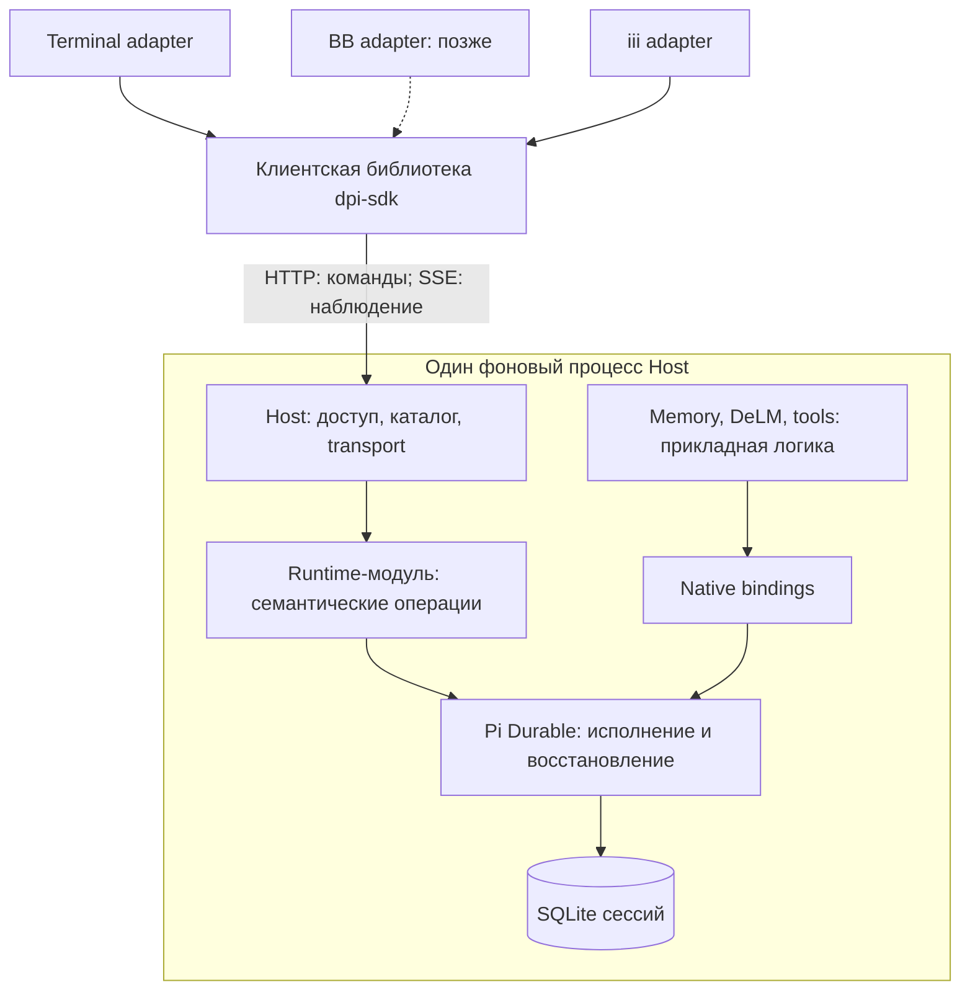

# Исходная архитектура перед сравнением с Herdr

Дата: 2 ноября 2026 года. Статус: запись обсуждённого варианта, не отчёт о готовности реализации.

Это исходная точка для [итогового архитектурного документа](ARCHITECTURE.md). Документ сохраняет смысл предыдущего обсуждения и не заменяет [DM1](../hot-update/DURABLE-MODULE-PLAN.md), [ISA](../../../ISA.md) или задания существующей команды DeLM.

## Задача

Обновлять Durable, собственные расширения и клиентские интерфейсы независимо там, где это допускают их контракты. Не размножать движки исполнения и не переносить детали upstream API во все приложения.

> 🧠 **From Hindsight memory (Durable-centred upgrade boundary and 1.5 migration)** — ранее выбрана локализация зависимости от Durable в глубоком runtime-модуле. Утверждённая реализация охватывает backend, SDK, terminal и iii; BB отложен. Эти ограничения сверены с DM1, а не приняты за свежий результат тестирования.

## Схема

`dpi-sdk` находится внутри клиентского приложения. Это библиотека, а не сервер и не дополнительный сетевой переход. Runtime-модуль находится внутри Host; он тоже не требует отдельного процесса.

Один Host обслуживает несколько сессий. У каждой открытой сессии один владелец native Harness. Каталог Host и SQLite-состояние исполнения имеют разные обязанности; каталог не становится второй машиной исполнения.

## Обязанности

| Компонент | Что ему принадлежит | Чего он не делает |
| --- | --- | --- |
| Клиент | Ввод, отображение, локальный черновик, соединение | Не исполняет сохранённую работу вместо Host |
| SDK | HTTP, версии протокола, SSE, ошибки, восстановление наблюдения | Не владеет Harness и SQLite |
| Host | Authentication, grants, каталог и маршрутизация | Не копирует scheduler и recovery Durable |
| Runtime-модуль | Native lifecycle, admission, безопасная проекция состояния, bindings и reload | Не раскрывает наружу Harness, Tx, LiveDoc и WatchCall |
| Durable | Native tasks, сохранённое состояние, исполнение и восстановление | Не рисует клиентский интерфейс |
| Прикладная логика расширений | Memory policy, правила DeLM, инструменты | Не читает private native documents без необходимости |
| Native bindings | Соединение прикладной логики со штатными tasks, hooks и registry | Не обещает совместимость с любым будущим upstream release |

## Контракты

- Прикладные операции: send, receipt, reconcile, interrupt, history, observe, configure и reload.
- Наблюдение: безопасный полный state, revision, ограниченные updates и resync при пропуске.
- История диалога отличается от текущего контекста модели.
- Приём запроса отличается от появления ответа и от состояния idle.
- Потерянный ответ HTTP не разрешает повторить действие с новым requestId.
- Проверка полномочий непосредственно перед native mutation остаётся атомарной.
- Disconnect снимает наблюдателя, но не останавливает уже принятую работу.

## Единицы обновления

Совместимое изменение расширения может применяться через существующие loader, `/reload` и `registry.install`. Ошибка подготовки сохраняет предыдущую рабочую версию.

Обновление Durable, его зависимостей или формата сохранённых данных требует отдельного собранного и проверенного runtime-релиза. Независимая упаковка не означает горячую замену ядра в работающем процессе.

Сторонний native extension требует проверки совместимости с конкретной версией Durable. Нельзя обещать его неизменность при произвольном breaking change.

## Ограничения исследования

- Рабочие Host и Pocket не перезапускаются и не обновляются.
- Production DB, credentials и установленный release не изменяются.
- Текущие задачи, claims и состав DeLM не меняются ради оформления архитектуры.
- Код продукта, ISA и DM1 не редактируются в рамках этого документа.
- Будущий кандидат остаётся неактивированным до отдельного разрешения.
- Нельзя открывать изменённую версией 1.5 БД под 1.4. Проверка возврата использует исходный runtime и отдельную исходную backup-copy.

## Что предстоит проверить сравнением

1. Где Herdr проводит границу core/app и за счёт чего переживает обновления.
2. Какие из его решений подходят агентному runtime, а какие относятся только к PTY и GUI.
3. Достаточно ли одного фонового Host или полезен отдельный runtime daemon.
4. Какие контракты действительно уменьшают связанность, а какие добавляют пустые обёртки.
5. Как объяснить эти границы без ошибочного впечатления, что SDK и каждый модуль являются отдельными серверами.
